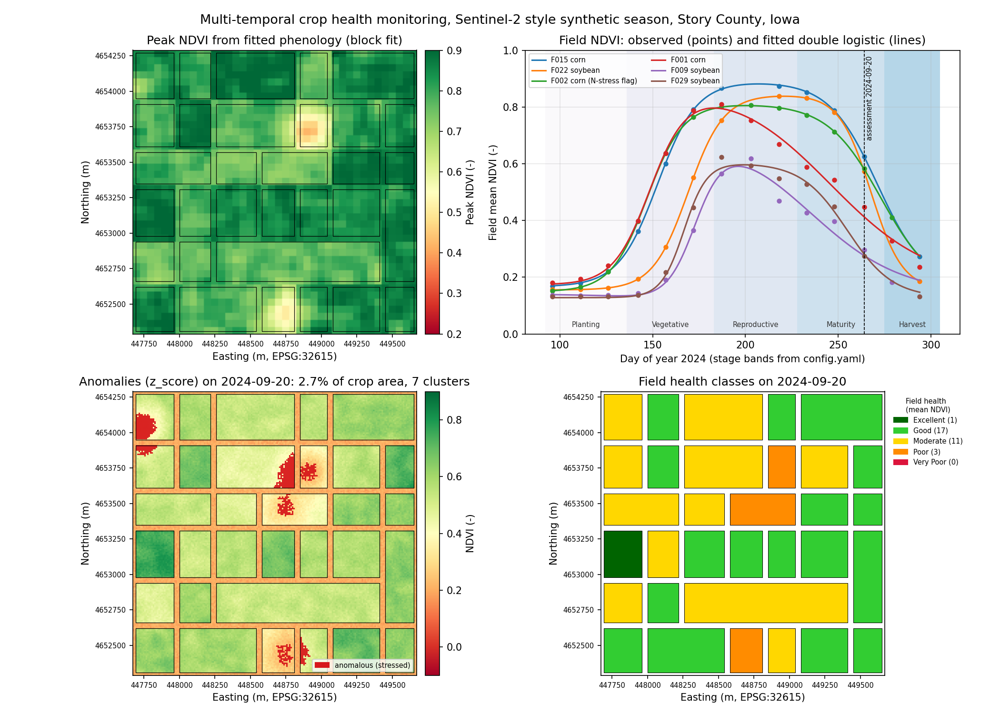
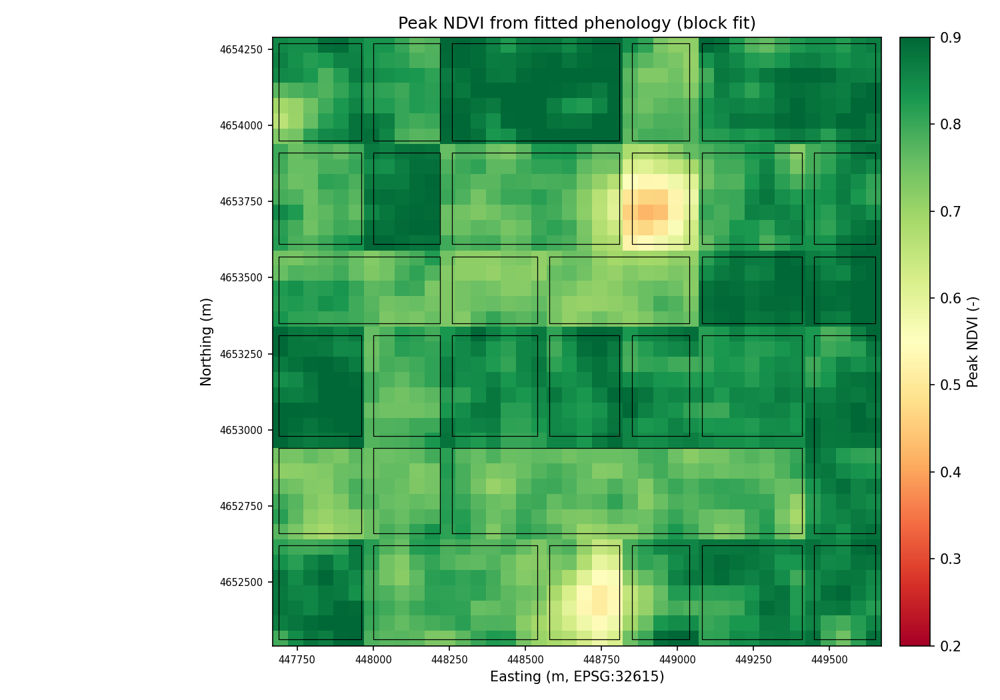
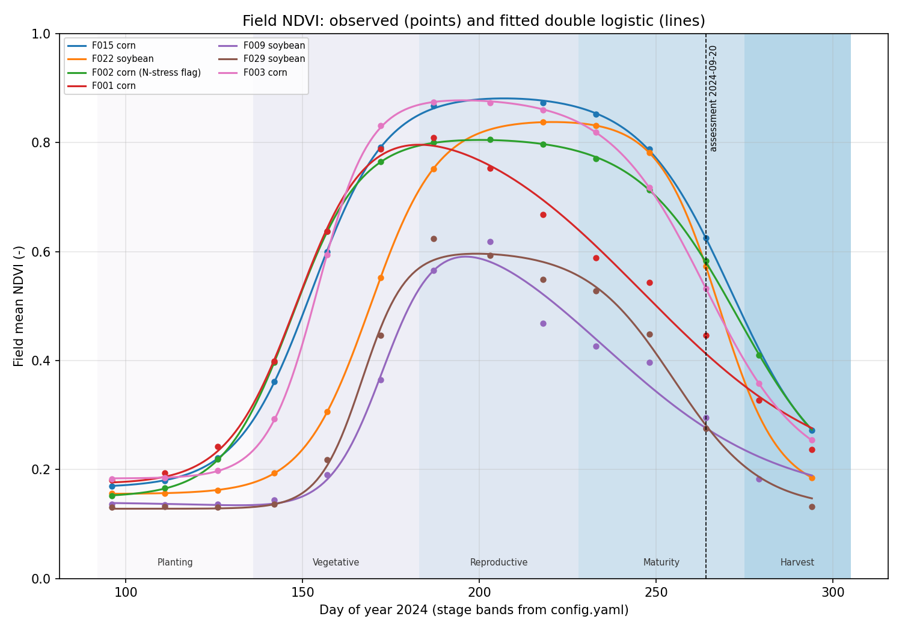
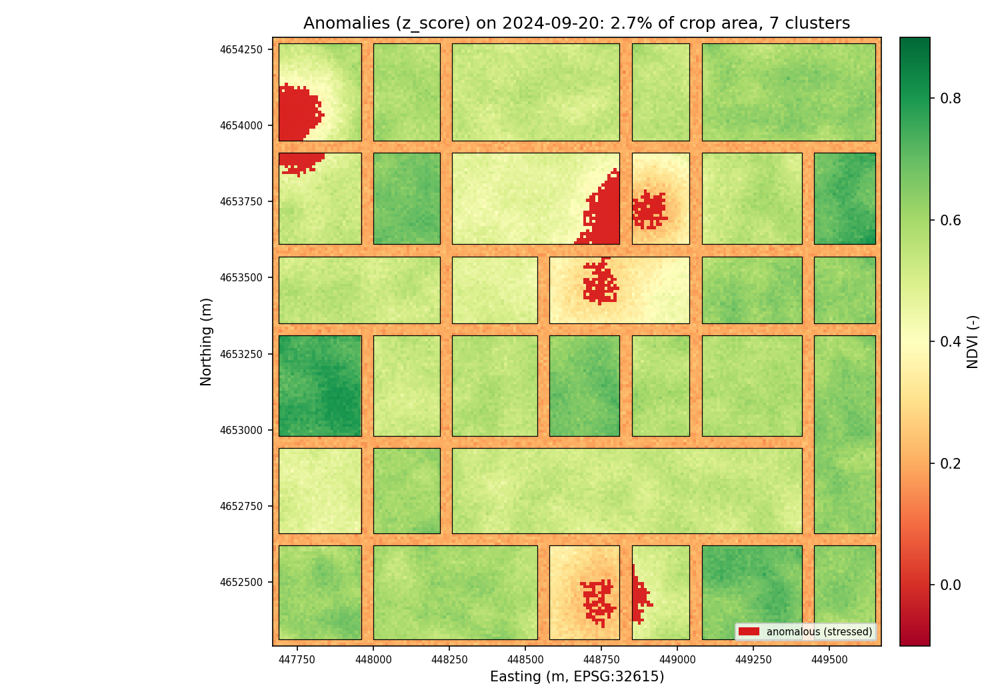
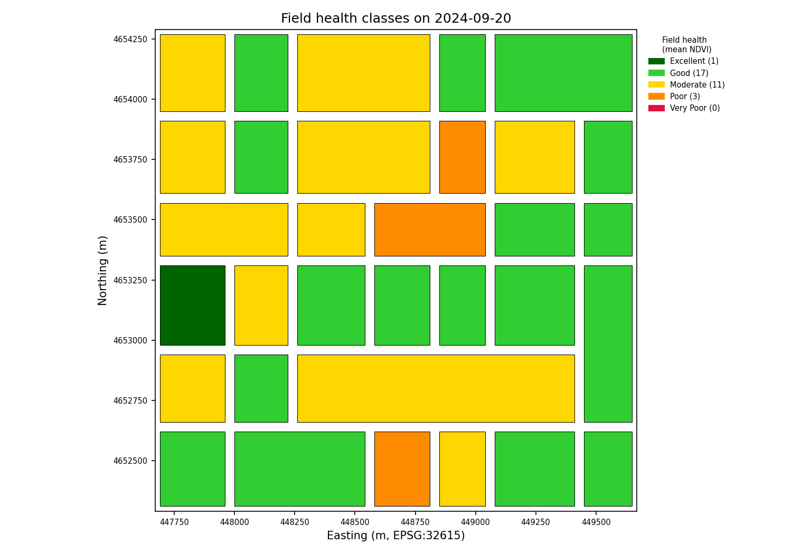
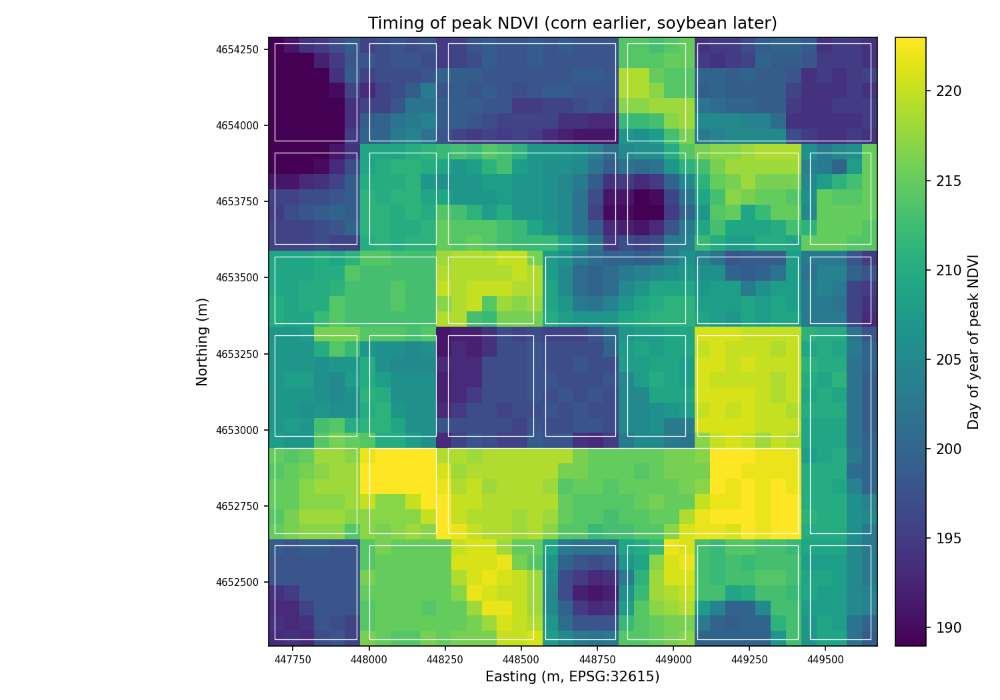
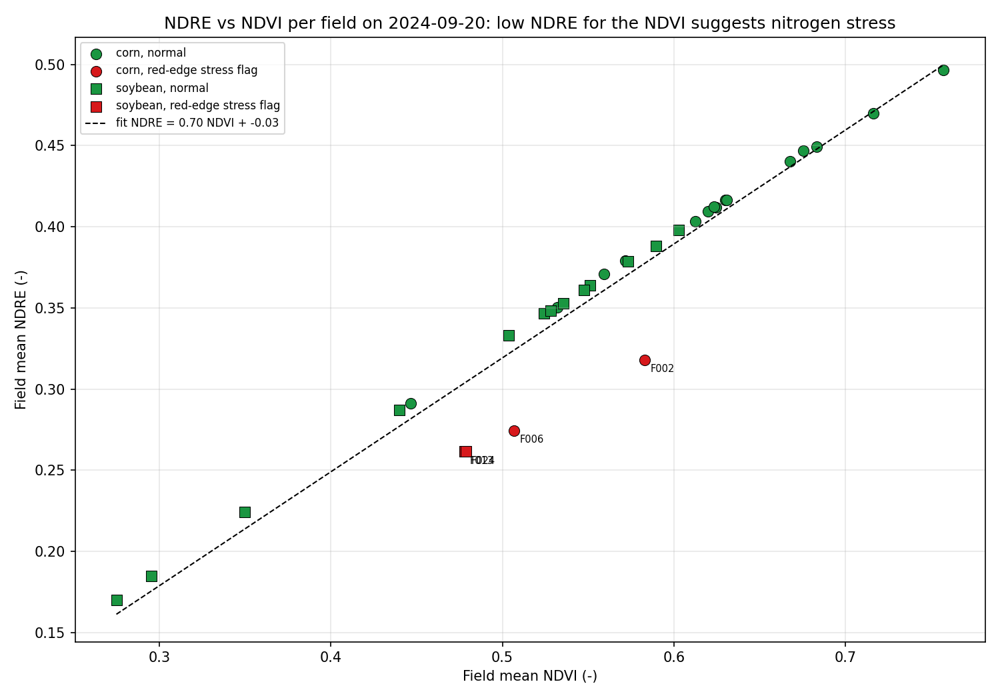
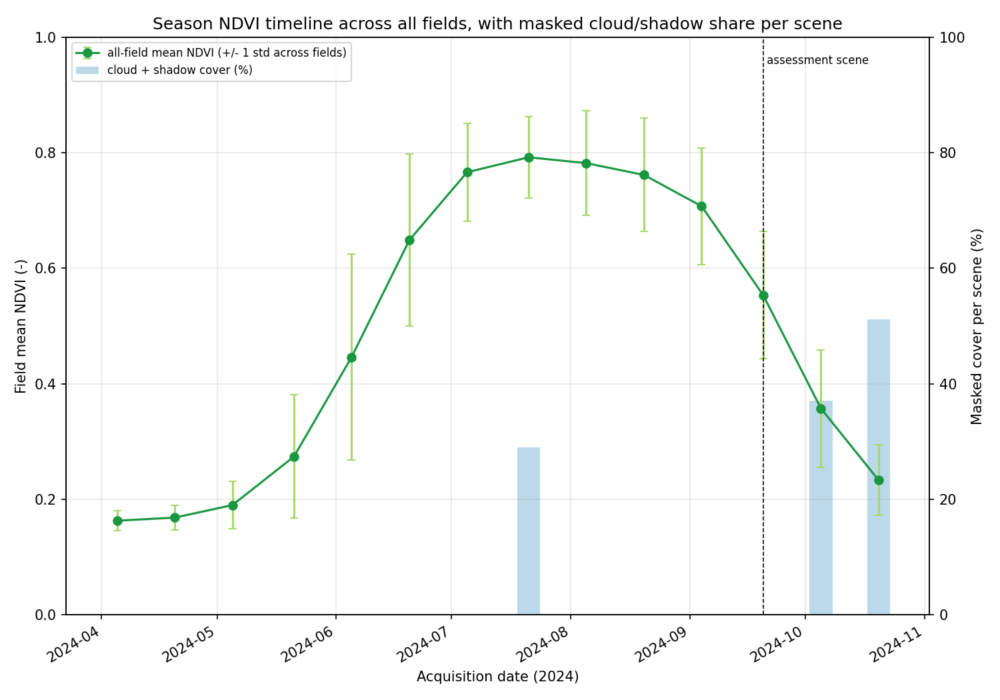

# 🌽 Multi-Temporal Crop Health Monitoring with Sentinel-2

[](https://www.python.org/)
[](https://qgis.org/)
[](https://github.com/bhargavchintam/qgis-geospatial-projects/actions/workflows/ci.yml)
[](LICENSE)



## What this does

Farm advisors need to know which fields are falling behind during the season, not after harvest. This project takes a stack of Sentinel-2 Level-2A scenes, computes five vegetation indices per date, fits a double-logistic phenology curve per field and per pixel block, and flags stressed patches on the latest cloud-free scene by comparing observed NDVI with the NDVI the field's own curve expects. The output is a set of GeoTIFFs (NDVI per date, peak NDVI, peak day of year, anomaly map), a per-field health table with classes and a nitrogen-stress flag from NDRE, figures and an interactive web map.

Built for: agronomists, crop consultants and GIS analysts who monitor corn and soybean fields with free satellite data.

## Try it

- Interactive map (no install): https://bhargavchintam.github.io/qgis-geospatial-projects/crop-health-ndvi-monitoring/docs/map.html
- Streamlit app: `streamlit run app.py` (runs on your machine; there is no hosted version yet)
- One-command demo:
  ```bash
  pip install -r requirements.txt
  python demo.py          # ~10 s, writes results/demo and docs/figures
  ```

The demo builds a synthetic but realistic season: 14 scene folders (April 5 to October 20, 2024) with the ten Sentinel-2 bands and the SCL layer as uint16 GeoTIFFs, 32 corn and soybean fields with road gaps, growing stress patches, four nitrogen-stressed fields and cloud blobs on three dates. The loader reads that folder exactly like real data.

## Results (from `python demo.py`, synthetic Story County, Iowa scene, seed 42)

| Metric | Value |
|--------|-------|
| Grid | 200 x 200 pixels at 10 m (EPSG:32615), 14 scenes, 32 fields (17 corn, 15 soybean) |
| Scenes masked above the 15 % cloud limit | 3 (2024-07-21 at 29 %, 2024-10-05 at 37 %, 2024-10-20 at 51 %) |
| Assessment scene (latest usable) | 2024-09-20 |
| Mean peak NDVI, crop pixels (block fit, 5 px) | 0.806 (corn fields 0.845 at DOY 203, soybean 0.742 at DOY 214) |
| Mean peak day of year / season length | 207 / 103 days (green-up to senescence midpoint), mean R2 0.997 |
| Anomalous crop area (z-score < -1.5, clusters >= 0.5 ha) | 2.71 % in 7 clusters (anomalous NDVI 0.31 vs normal 0.56) |
| Same scene with Isolation Forest | 2.51 % in 5 clusters |
| Fields per health class on 2024-09-20 | Excellent 1, Good 17, Moderate 11, Poor 3, Very Poor 0 |
| Top 5 stressed fields (mean NDVI) | F029 0.275, F009 0.295, F014 0.350, F008 0.440, F001 0.447 |
| Fields flagged for red-edge (nitrogen) stress | 4 (F002, F006, F013, F024), matching the 4 fields simulated with low chlorophyll |
| Fields declining in the last period (10-05 to 10-20) | 29 of 29 with data (normal senescence) |
| Runtime | 8.0 s pipeline plus figures on a 4-core sandbox |

The three lowest fields (F029, F009, F014) each host a simulated stress patch that grew to cover much of the field, so they drop to whole-field "Poor" and only their worst cores are flagged. F001 (corn) hosts a smaller patch and has the highest anomalous share of any field (24 % of its pixels), followed by F009 (16 %) and F008 (13 %).

## Figures


Peak NDVI of the fitted phenology curve per 5 x 5 pixel block, with field outlines. Light spots are stress patches.


Observed field-mean NDVI (points) and the fitted double logistic (lines) for six fields, with the config phenology stages shaded. Corn peaks earlier and higher than soybean.


Stressed pixels (red) on the 2024-09-20 NDVI image: observed NDVI far below the field's expected value.


Field health classes from the mean NDVI on the assessment scene.


Day of year of peak NDVI. Corn fields peak around DOY 203, soybean around DOY 214, and stress patches peak early.


Field mean NDRE against NDVI. Fields far below the fitted line have less chlorophyll for their canopy and are flagged as likely nitrogen stress.


All-field mean NDVI over the season with the masked cloud and shadow share of each scene.

## How it works

1. **Load scenes.** Each `S2*_MSIL2A_<YYYYMMDD>*` folder holds `B02 ... B12.tif` and `SCL.tif`. DN are divided by 10000 to get reflectance, 20 m bands (B05, B06, B07, B8A, B11, B12) are resampled to the 10 m grid with bilinear interpolation, the SCL layer with nearest neighbour, and SCL classes 0, 1, 2, 3, 8, 9, 10 (no data, saturated, dark, shadow, cloud, cirrus) become NaN in every band.
2. **Vegetation indices** per scene (`src/index_calculator.py`):

   | Index | Formula | Application |
   |-------|---------|-------------|
   | **NDVI** | (NIR - Red) / (NIR + Red) | General vegetation vigor |
   | **EVI** | 2.5 x (NIR - Red) / (NIR + 6 x Red - 7.5 x Blue + 1) | Enhanced vegetation, reduces atmospheric effects |
   | **SAVI** | (NIR - Red) / (NIR + Red + L) x (1 + L), L = 0.5 | Soil-adjusted vegetation, sparse canopy |
   | **NDRE** | (NIR - RedEdge) / (NIR + RedEdge) | Chlorophyll content, nitrogen stress |
   | **NDWI** | (Green - NIR) / (Green + NIR) | Crop water content / moisture stress |

3. **Time series smoothing.** NDVI is stacked as `[time, rows, cols]`. Cloud gaps are linearly interpolated along time (vectorised, no per-pixel loop) and a Savitzky-Golay filter (window 5, order 2) runs along the time axis.
4. **Phenology fit.** The double logistic `f(t) = a1 + a2 (1/(1+e^(-a3 (t-a4))) - 1/(1+e^(-a5 (t-a6))))` is fitted with `scipy.optimize.curve_fit` on the block-mean series of every 5 x 5 pixel block (1600 fits instead of 40000; `block_size=1` gives the per-pixel fit) and the parameters are repeated back to full resolution. Peak NDVI and peak DOY come from the fitted curve on a daily grid; season length is `a6 - a4`. One more curve is fitted per field on the field-mean series (fields rasterised with `rasterio.features.rasterize`).
5. **Anomaly detection.** The assessment scene is the latest one under `cloud_cover_max`. For every crop pixel the residual `observed NDVI - field expected NDVI` is z-scored across the scene; pixels below `z_score_threshold` (-1.5) are stressed, and connected clusters smaller than `min_cluster_ha` (0.5 ha) are dropped. Isolation Forest on local features (value, local mean, local std, deviation, gradient) is available for comparison.
6. **Field statistics.** `rasterstats` zonal mean, median, std, min, max, 10th and 90th percentile per field, date and index; health classes from mean NDVI (Excellent >= 0.75, Good >= 0.55, Moderate >= 0.35, Poor >= 0.20, else Very Poor); change between consecutive scenes (declining if the drop is more than 0.02); anomalous share per field; and an NDRE flag: a line `NDRE = a NDVI + b` is fitted across fields and fields more than one standard deviation below it are flagged.

## Use it in QGIS

- `qgis/styles/ndvi.qml`: RdYlGn pseudocolor from -0.2 to 0.9 for any NDVI raster (`results/demo/rasters/ndvi_20240920.tif`, `peak_ndvi.tif`).
- `qgis/styles/crop_anomaly.qml`: exact classes for `anomaly_map.tif` (0 normal, almost transparent; 1 anomaly, red).
- `qgis/styles/field_health.qml`: categorized fill on `health_class` for `fields_assessment.geojson`.
- `qgis/processing/crop_ndvi_health_algorithm.py`: Processing Toolbox script "NDVI and Crop Health Classes (Portfolio)" that takes a red and a NIR raster, a DN scale factor and the four class thresholds, and writes an NDVI raster plus a five-class health raster.
- Load a style with Layer Properties > Symbology > Style > Load Style; install the script with Processing Toolbox > Scripts > Create New Script. Details in [qgis/README.md](qgis/README.md).

## Use it with real data

| Source | What to take | Link |
|--------|--------------|------|
| Copernicus Data Space / Open Access Hub | Sentinel-2 Level-2A tiles (T15TVG covers Story County) | https://dataspace.copernicus.eu/ |
| USDA CropScape | Cropland Data Layer to label corn and soybean fields | https://nassgeodata.gmu.edu/CropScape/ |
| USDA NASS Quick Stats | County level planting and harvest dates | https://quickstats.nass.usda.gov/ |
| OpenStreetMap / county parcels | Field boundary polygons | https://www.openstreetmap.org/ |
| PRISM | Gridded precipitation and temperature for stress interpretation | https://prism.oregonstate.edu/ |

Steps: export each scene's `B02, B03, B04, B05, B06, B07, B08, B8A, B11, B12` and `SCL` as GeoTIFFs into `data/sentinel2/S2A_MSIL2A_<YYYYMMDD>T<HHMMSS>_<tile>/` (20 m bands can stay at 20 m), save your field polygons with a `field_id` column (and optionally `crop`) as `data/field_boundaries.geojson`, then set `study_area.sentinel_dir`, `study_area.field_boundaries`, `growing_season.start/end` and the thresholds in `config.yaml`. Run `python scripts/run_pipeline.py --config config.yaml --output results/real --figures`. Optional `sentinelsat` (commented in `requirements.txt`) can automate the download.

## Project structure

```
crop-health-ndvi-monitoring/
├── README.md
├── LICENSE
├── requirements.txt
├── config.yaml                 # bands, season, thresholds, anomaly and demo settings
├── demo.py                     # synthetic season -> full pipeline -> figures + map
├── app.py                      # Streamlit app
├── src/
│   ├── __init__.py
│   ├── synthetic_data.py       # generate_demo_data(size, seed, out_dir)
│   ├── sentinel_loader.py      # scene discovery, DN scaling, resampling, SCL mask
│   ├── index_calculator.py     # NDVI, EVI, SAVI, NDRE, NDWI, GNDVI, CIre
│   ├── time_series.py          # smoothing, block/field phenology fits, peak metrics
│   ├── anomaly_detector.py     # z-score, Isolation Forest, LOF, cluster filter
│   ├── zonal_stats.py          # per-field stats, change report, health classes, NDRE flag
│   ├── pipeline.py             # run_pipeline(): the orchestration used by demo, app, tests
│   ├── visualize.py            # figures and build_web_map()
│   └── utils.py
├── scripts/run_pipeline.py     # CLI for real scenes
├── qgis/
│   ├── README.md
│   ├── styles/ndvi.qml, crop_anomaly.qml, field_health.qml
│   └── processing/crop_ndvi_health_algorithm.py
├── tests/                      # test_index_calculator, test_time_series, test_demo
├── docs/
│   ├── figures/00_hero.png ... 07_ndvi_timeline.png
│   └── map.html
└── results/                    # git-ignored demo output
```

## Tests

```bash
python -m pytest tests -q      # 31 passed in about 3 s
```

`tests/test_demo.py` runs the synthetic generator and the whole pipeline at 40 x 40 pixels, checks shapes, value ranges, output files, a figure and the web map, and enforces the 10 s budget. `tests/test_time_series.py` checks the vectorised gap filling against `np.interp`, and that the block fit returns full-resolution parameters with the peak inside the season.

## Author

Bhargav Chintam, https://github.com/bhargavchintam. MIT License.
