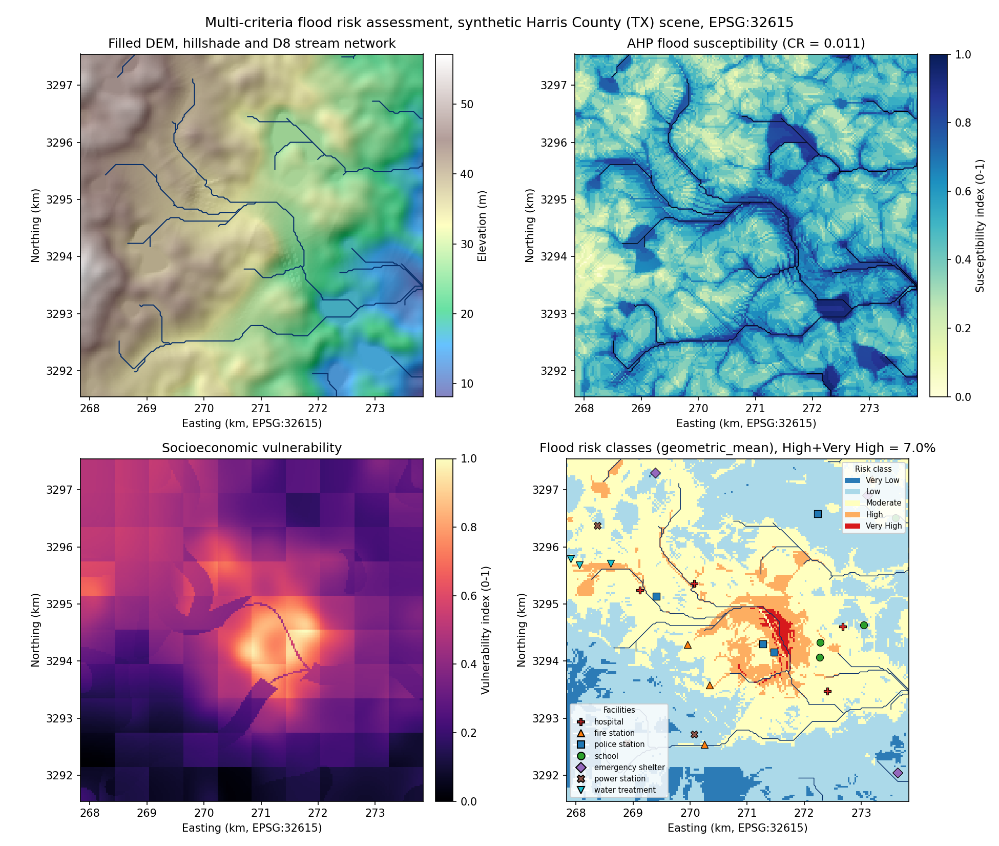
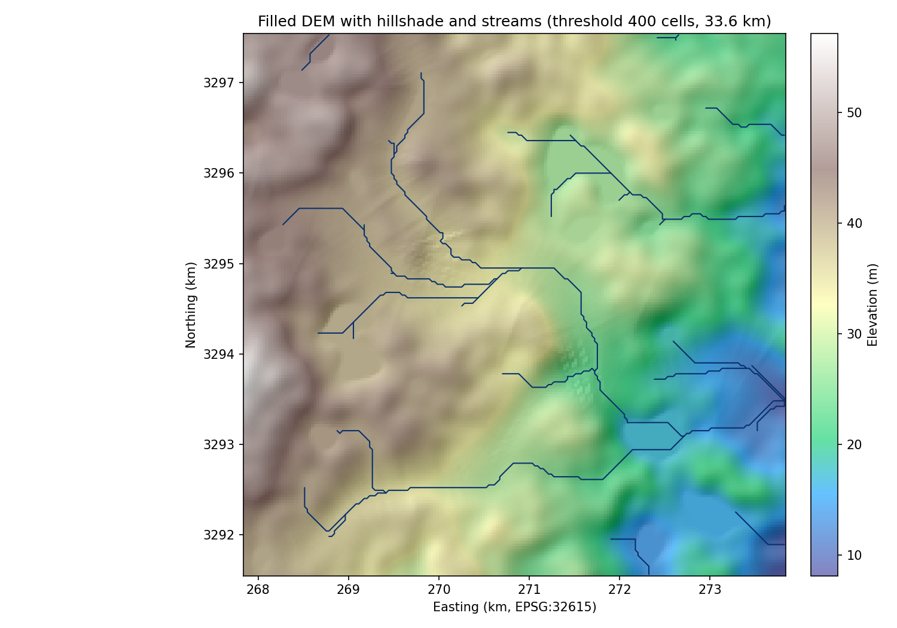
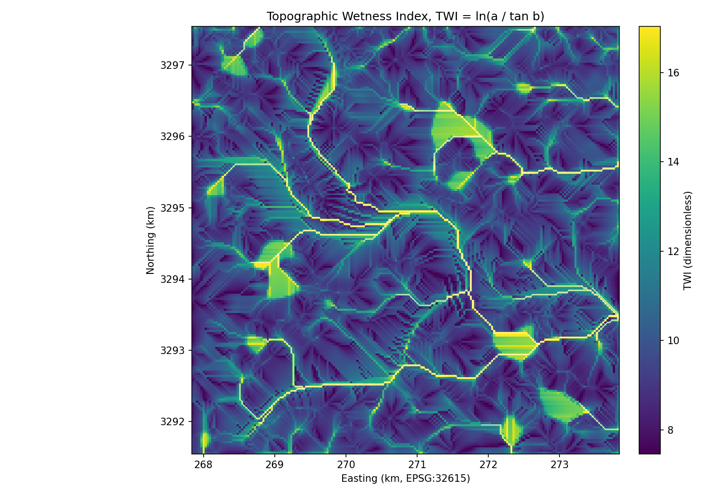
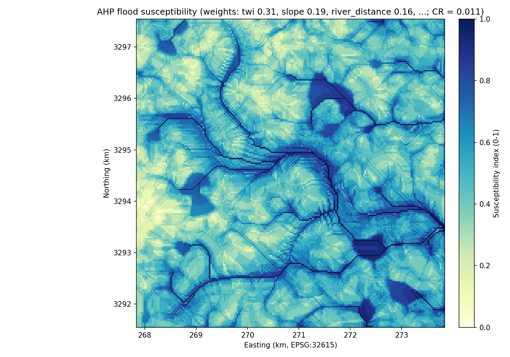
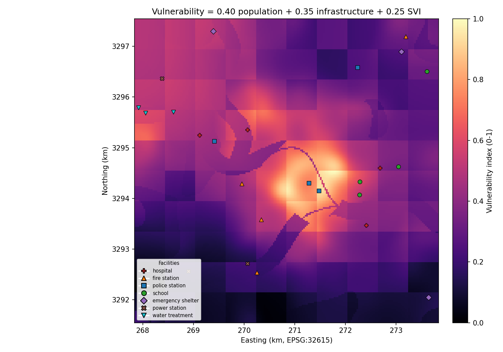
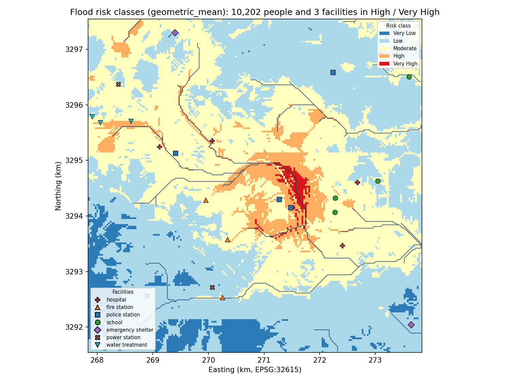
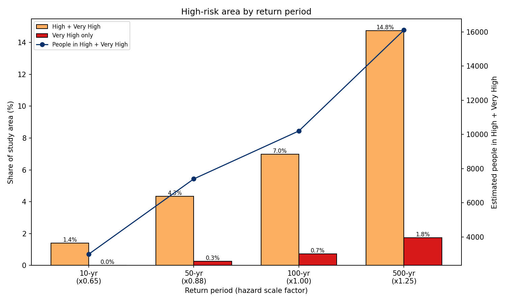
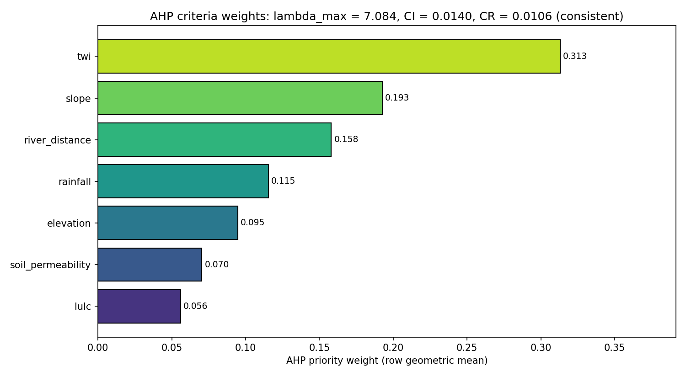

# 🌊 Multi-Criteria Flood Risk Assessment (AHP + DEM hydrology)

[](https://www.python.org/)
[](https://qgis.org/)
[](https://github.com/bhargavchintam/qgis-geospatial-projects/actions/workflows/ci.yml)
[](LICENSE)



## What this does

Flood risk depends on where water collects and on who and what sits there. This project derives hydrology from a DEM (sink filling, D8 flow, TWI, streams), combines seven criteria with Analytic Hierarchy Process (AHP) weights into a flood susceptibility map, and multiplies it with a vulnerability map built from population, critical facilities and social vulnerability. The output is a 0 to 1 risk index, five risk classes as polygons, people and facilities exposed per class, and the same numbers for 10, 50, 100 and 500-year return periods.

Built for: county emergency managers, floodplain planners and GIS analysts who need a transparent, reproducible screening-level risk map before running hydraulic models.

## Try it

- Interactive map (no install): https://bhargavchintam.github.io/qgis-geospatial-projects/flood-risk-assessment/docs/map.html
- Streamlit app: `streamlit run app.py`  (live link placeholder: https://flood-risk-assessment.streamlit.app, fill in after deploy)
- One-command demo:
  ```bash
  pip install -r requirements.txt
  python demo.py          # ~2 s, writes results/demo and docs/figures
  ```
  Options: `--size 200 --seed 42 --stream-threshold 400 --risk-method geometric_mean --out results/demo`

## Results (from `python demo.py`, synthetic Harris County (TX) scene, seed 42)

Scene: 200 x 200 cells at 30 m (36.0 km2), EPSG:32615, centred on downtown Houston. 2,293 sink cells were filled; the stream network (accumulation >= 400 cells) is 981 cells, 33.6 km.

| Metric | Value |
|---|---|
| AHP weights (TWI, slope, river distance, rainfall, elevation, Ksat, land cover) | 0.313, 0.193, 0.158, 0.115, 0.095, 0.070, 0.056 |
| AHP consistency | lambda_max 7.084, CI 0.0140, CR 0.0106 (consistent, < 0.10) |
| Susceptibility classes (very low / low / moderate / high / very high) | 2.0 / 27.9 / 44.7 / 18.7 / 6.7 % |
| Mean susceptibility / mean vulnerability / mean risk | 0.499 / 0.347 / 0.394 |
| Risk classes, 100-yr (very low / low / moderate / high / very high) | 6.46 / 47.24 / 39.31 / 6.25 / 0.73 % |
| Risk classes, 100-yr, area | 2.33 / 17.01 / 14.15 / 2.25 / 0.26 km2 |
| High + Very High risk area | 6.98 % (2.51 km2) |
| Population in High + Very High | 10,202 of 38,100 |
| Critical facilities in High + Very High (spatial join) | 3 of 25 (2 water treatment, 1 police station) |
| High + Very High area by return period (10 / 50 / 100 / 500-yr) | 1.40 / 4.34 / 6.98 / 14.75 % |
| People in High + Very High by return period | 2,993 / 7,396 / 10,202 / 16,104 |
| Runtime | 2.1 s (data + pipeline + 8 figures + web map) |

`results/demo/summary.json` has every number; `results/demo/rasters/` and `results/demo/vectors/` hold the GeoTIFFs and GeoPackages.

## Figures


Filled DEM with hillshade and the D8 stream network; the main bayou drains west to east with two tributaries.


Topographic Wetness Index; bright values mark channels and flat, water-collecting ground.


AHP flood susceptibility (0 to 1) from the seven weighted criteria, CR = 0.011.


Vulnerability from population density, critical facility density and the census SVI grid.


Five risk classes with critical facilities by type; High and Very High follow the bayou through the urban core.


High-risk share of the area and exposed population for the 10, 50, 100 and 500-year return periods.


AHP priority weights from the pairwise comparison matrix (row geometric mean).

## How it works

1. **Sink filling.** Priority-flood (Barnes et al. 2014): all edge cells go on a min-heap, cells are popped lowest first and each unvisited neighbour is raised to at least `popped + epsilon`. Every filled cell keeps a strictly lower neighbour, so there are no flats and no loops.
2. **Slope** by Horn's 3 x 3 method (degrees).
3. **D8 flow direction.** The eight neighbour drops (elevation difference / distance) are stacked and the steepest positive drop wins (vectorised with numpy). **Flow accumulation** is a topological traversal from source cells; in-degree is computed with numpy.
4. **TWI.** `TWI = ln(a / tan(b))`, with `a` the specific catchment area (`flow accumulation x cell size`, m2 per m of contour) and `b` the slope. Streams are cells with accumulation >= the threshold (400 cells = 0.36 km2 in the demo); distance to streams is a Euclidean distance transform.
5. **AHP weights.** A 7 x 7 pairwise comparison matrix on the Saaty 1 to 9 scale gives priority weights by the row geometric mean method, `w_i = (prod_j a_ij)^(1/n) / sum_k (prod_j a_kj)^(1/n)`. Consistency: `CI = (lambda_max - n) / (n - 1)`, `CR = CI / RI` with `RI = 1.32` for n = 7; accepted when CR < 0.10.

   | Criterion | Weight | Direction | Source (real data) |
   |---|---|---|---|
   | Topographic Wetness Index (TWI) | 0.313 | higher = more prone | DEM-derived |
   | Slope | 0.193 | flatter = more prone | DEM-derived |
   | Distance to river network | 0.158 | closer = more prone | stream network |
   | Rainfall intensity (100-yr 24-h) | 0.115 | higher = more prone | NOAA Atlas 14 |
   | Elevation | 0.095 | lower = more prone | DEM |
   | Soil permeability (Ksat) | 0.070 | lower = more prone | SSURGO |
   | Land use / land cover | 0.056 | more impervious = more prone | NLCD |

6. **Flood susceptibility.** Each criterion is scored 0 to 1 (score tables in `config.yaml` for TWI, slope, elevation and distance; percentile-clipped min-max scaling for rainfall and Ksat; an NLCD lookup for land cover), combined as `sum(w_i x score_i)` and stretched to 0 to 1.
7. **Vulnerability.** `0.40 x population density + 0.35 x critical infrastructure density + 0.25 x SVI`. Facility density is a gaussian kernel (2 km) over points weighted by criticality (hospital, shelter, water treatment 5; fire, police, power 4; school 3).
8. **Risk framework.**
   ```
   Risk = f(Hazard, Vulnerability)
     Hazard        = Flood susceptibility x return-period factor (0.65 / 0.88 / 1.00 / 1.25)
     Vulnerability = population exposure + critical infrastructure + social vulnerability (SVI)
     geometric_mean (default): Risk = sqrt(Hazard x Vulnerability)
     multiplicative:           Risk = Hazard x Vulnerability
     matrix:                   5 x 5 hazard-by-vulnerability lookup
   ```
   Classes at 0.2 / 0.4 / 0.6 / 0.8 are vectorised to polygons; population per class is density x pixel area; facilities are joined onto the class polygons.

## Use it in QGIS

- `qgis/styles/flood_risk_index.qml` (raster pseudocolor 0 to 1), `twi.qml` (viridis), `flood_risk_zones.qml` (categorized on `risk_label`, blue to red) and `critical_infrastructure.qml` (markers by `type`).
- `qgis/processing/flood_weighted_overlay_algorithm.py` adds "AHP Weighted Overlay (Portfolio)" to the Processing Toolbox: pick N criterion rasters, paste the weights and invert flags, get the 0 to 1 overlay.
- Load a style with Layer Properties > Symbology > Style > Load Style; install the script with Processing Toolbox > Scripts > Create New Script.
- Details in [qgis/README.md](qgis/README.md).

## Use it with real data

| Layer | Source | config.yaml key |
|---|---|---|
| DEM (10 m) | [USGS 3DEP](https://www.usgs.gov/3d-elevation-program) | `dem.source`, `dem.resolution` |
| 100-yr rainfall depth (mm) | [NOAA Atlas 14](https://hdsc.nws.noaa.gov/pfds/) | `inputs.rainfall` |
| Soil Ksat | [NRCS SSURGO](https://www.nrcs.usda.gov/resources/data-and-reports/soil-survey-geographic-database-ssurgo) | `inputs.soil_permeability` |
| Land cover codes | [NLCD](https://www.mrlc.gov/) | `inputs.lulc` |
| Population density (people/km2) | Census / WorldPop | `inputs.population` |
| Critical facilities (points, `type` column) | [HIFLD](https://hifld-geoplatform.opendata.arcgis.com/) | `inputs.infrastructure` |
| Social vulnerability (polygons, `RPL_THEMES`) | [CDC/ATSDR SVI](https://www.atsdr.cdc.gov/placeandhealth/svi/) | `inputs.socioeconomic` |

Reproject all rasters to one UTM grid (same extent and cell size) first, set the paths in `config.yaml`, adjust the score tables to your terrain (the demo tables are for a flat coastal plain at 30 m), then run `python scripts/run_pipeline.py --config config.yaml --output results/run --figures`.

## Project structure

```
flood-risk-assessment/
├── README.md
├── LICENSE
├── requirements.txt
├── config.yaml                  # paths, AHP matrix, score tables, weights, scenarios
├── demo.py                      # one-command demo (synthetic scene -> results, figures, map)
├── app.py                       # Streamlit app
├── src/
│   ├── synthetic_data.py        # generate_demo_data(): Harris County scene, EPSG:32615, 30 m
│   ├── dem_processor.py         # priority-flood fill, slope, D8, accumulation, TWI, streams
│   ├── ahp.py                   # AHP weights (row geometric mean) and consistency ratio
│   ├── flood_susceptibility.py  # AHP weighted overlay, classes, return-period scenarios
│   ├── vulnerability.py         # population + facilities + SVI
│   ├── risk_calculator.py       # risk index, classes, polygons, exposure, facilities at risk
│   ├── pipeline.py              # run_pipeline(): the whole chain in one call
│   ├── visualize.py             # figures and build_web_map()
│   └── utils.py
├── scripts/run_pipeline.py      # runner for real data listed in config.yaml
├── qgis/                        # .qml styles, Processing algorithm, README
├── tests/                       # test_ahp.py, test_dem_processor.py, test_demo.py
├── docs/figures/*.png, docs/map.html
└── results/                     # git-ignored demo output
```

## Tests

```bash
python -m pytest tests -q      # 26 passed
```

## Author

Bhargav Chintam, https://github.com/bhargavchintam. MIT License.
