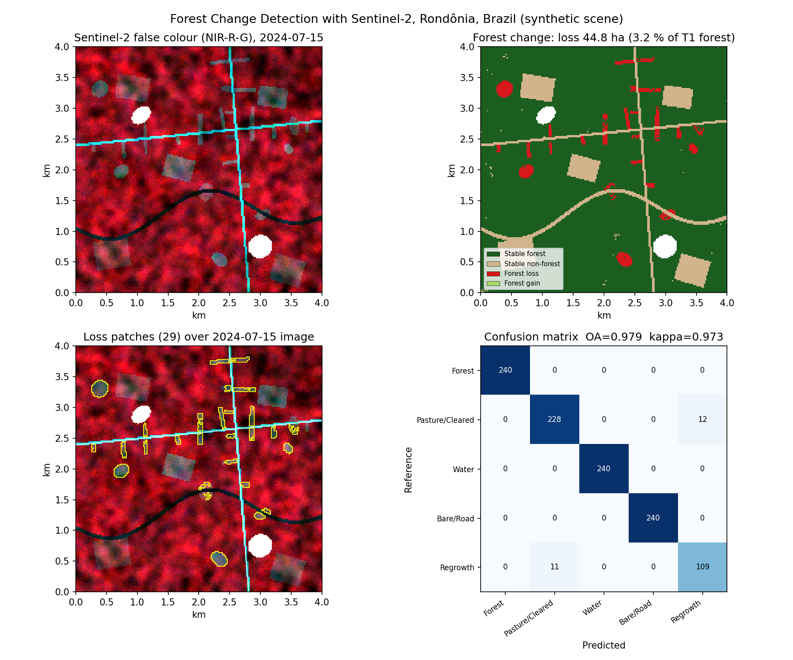
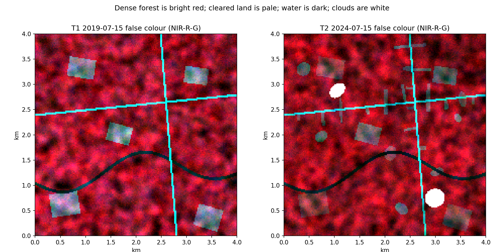
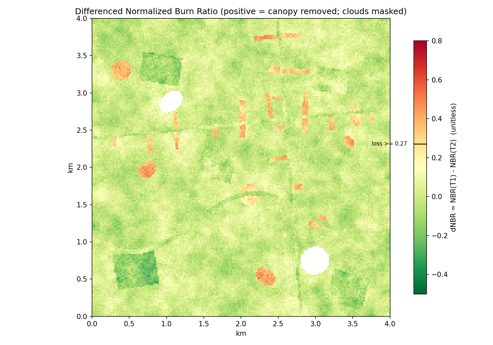
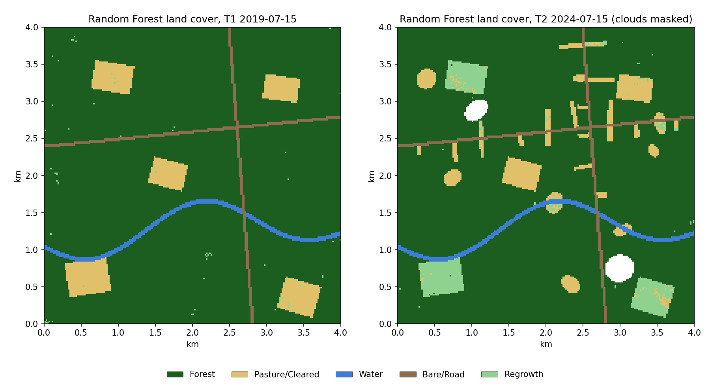
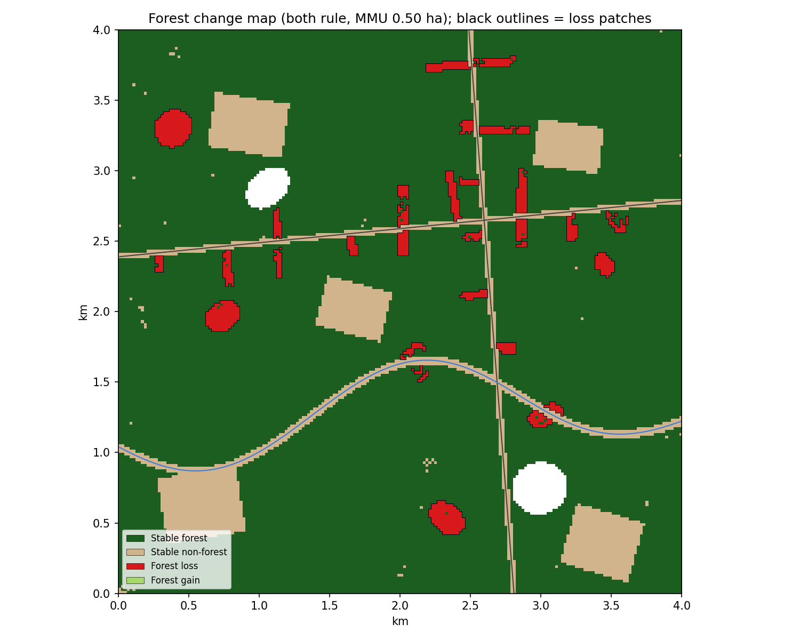
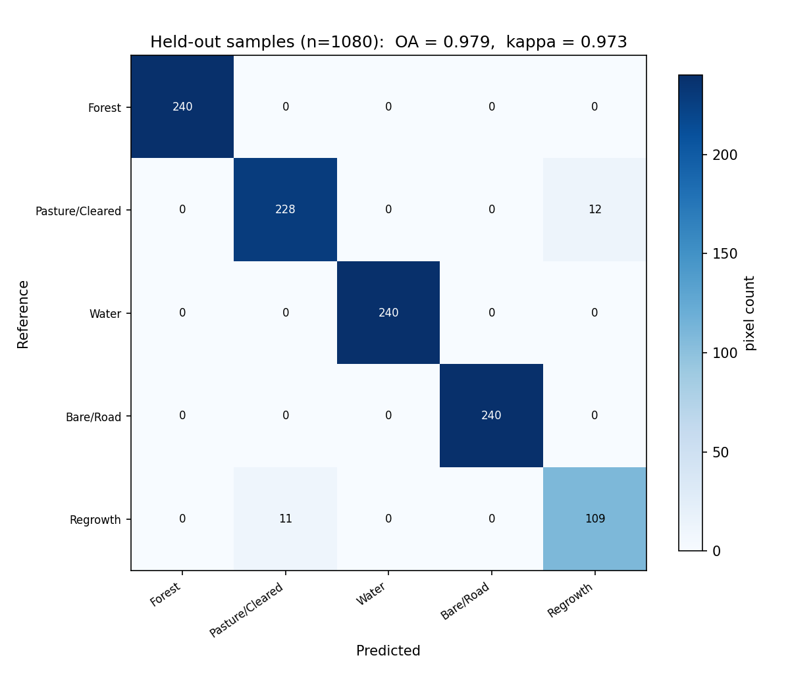
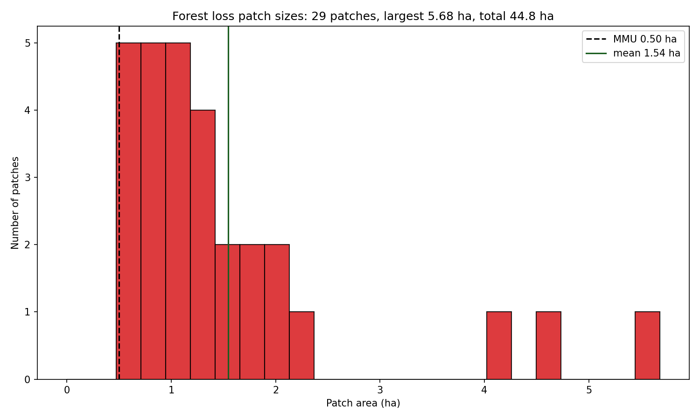
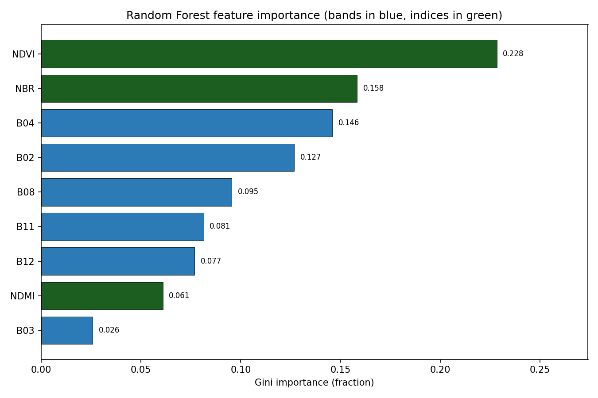

# 🌳 Forest Change Detection with Sentinel-2

[](https://www.python.org/)
[](https://qgis.org/)
[](https://github.com/bhargavchintam/qgis-geospatial-projects/actions/workflows/ci.yml)
[](LICENSE)



## What this does

Maps where forest was cleared between two Sentinel-2 dates in Rondônia, Brazil, the "arc of deforestation". A Random Forest classifies both images into five land-cover classes, and forest loss is confirmed only where the class change and the dNBR spectral change agree. The output is a change raster, loss polygons with area and distance to roads, an accuracy report and forest area statistics.

Built for: forest monitoring analysts, REDD+ reporting teams, and GIS students who want a complete, testable change-detection workflow.

## Try it

- Interactive map (no install): https://bhargavchintam.github.io/qgis-geospatial-projects/forest-change-detection/docs/map.html
- Streamlit app: `streamlit run app.py` (runs on your machine; there is no hosted version yet)
- One-command demo:
  ```bash
  pip install -r requirements.txt
  python demo.py          # ~3 s, writes results/demo and docs/figures
  ```

## Results (from `python demo.py`, synthetic Rondônia scene, seed 42)

Scene: 200 x 200 pixels at 20 m (4 km x 4 km), EPSG:32720, T1 = 2019-07-15, T2 = 2024-07-15 (5.0 years).

| Metric | Value |
|---|---|
| Overall accuracy (1080 held-out pixels) | 0.979 |
| Kappa | 0.973 |
| Producer's / user's accuracy: Forest | 1.000 / 1.000 |
| Producer's / user's accuracy: Pasture/Cleared | 0.950 / 0.954 |
| Producer's / user's accuracy: Water | 1.000 / 1.000 |
| Producer's / user's accuracy: Bare/Road | 1.000 / 1.000 |
| Producer's / user's accuracy: Regrowth | 0.908 / 0.901 |
| Forest area T1 | 1420.8 ha |
| Forest area T2 | 1368.3 ha |
| Forest loss (both rules agree, MMU 0.5 ha) | 44.8 ha (3.15 % of T1 forest) |
| Annual loss rate | 0.63 % per year |
| Forest gain | 0.0 ha |
| Loss patches | 29 (mean 1.54 ha, largest 5.68 ha) |
| Loss within 500 m of a road | 87.3 % |
| Synthetic truth loss | 53.9 ha, 83.0 % detected, 0.0 ha false alarms |
| Top 3 features | NDVI 0.23, NBR 0.16, B04 0.15 |
| Pipeline runtime | 1.4 s (about 3 s with imports) |

Post-classification alone flags 54.6 ha and dNBR alone flags 46.0 ha. Requiring both drops the loss to 44.8 ha with zero false alarms, which is the point of the conservative rule.

## Figures


*Sentinel-2 false colour (NIR, red, green) at both dates. Forest is bright red, new clearings are pale strips along the roads, clouds are white.*


*Differenced NBR. Positive values (orange, red) mark canopy removal, the black line on the colour bar is the 0.27 loss threshold, regrowth blocks are green.*


*Random Forest land cover at T1 and T2 with a shared legend. Clouds at T2 are masked to no data.*


*Final change map after the "both agree" rule and the minimum mapping unit. Black outlines are the vectorised loss patches.*


*Error matrix on the held-out 30 % samples. Most confusion is between pasture and regrowth.*


*Size distribution of the loss patches. The dashed line is the minimum mapping unit.*


*Random Forest feature importance. The indices (NDVI, NBR) and the red band do most of the work.*

## How it works

1. **Feature stack.** Six Sentinel-2 L2A bands (B02, B03, B04, B08, B11, B12) at 20 m plus three indices, nine features per pixel:
   `NDVI = (NIR - Red) / (NIR + Red)`, `NBR = (NIR - SWIR2) / (NIR + SWIR2)`, `NDMI = (NIR - SWIR1) / (NIR + SWIR1)`.
2. **Stratified sampling.** Up to 400 pixels per class and per date are drawn at random from the reference map, then split 70 / 30 into training and held-out test pixels. Cloud pixels are never sampled. Samples from both dates are pooled so the model sees both illumination conditions.
3. **Random Forest.** `RandomForestClassifier(n_estimators=100, n_jobs=-1, random_state=42)` from scikit-learn. Both dates are classified with the same model. Cloud pixels at T2 become no data (0).
4. **Accuracy metrics** on the held-out pixels, from the error matrix `cm` (rows = reference, columns = predicted, N = total):
   `OA = trace(cm) / N`,
   `kappa = (p_o - p_e) / (1 - p_e)` with `p_o = OA` and `p_e = sum_i(row_i * col_i) / N^2`,
   `producer's accuracy_i = cm[i,i] / row_i` (1 - omission error), `user's accuracy_i = cm[i,i] / col_i` (1 - commission error).
5. **Post-classification comparison.** Pixel by pixel: forest at T1 and non-forest at T2 is candidate loss (3), the reverse is gain (4), otherwise stable forest (1) or stable non-forest (2). No data in either date gives 0. Regrowth (class 5) counts as non-forest.
6. **dNBR.** `dNBR = NBR(T1) - NBR(T2)`, following the USGS "pre minus post" convention so that positive values mean vegetation was removed. The loss cut is `dNBR >= 0.27`, the USGS burn-severity break between "low" and "moderate-low" severity. Canopy removal by clearing behaves like a burn in the NIR / SWIR2 space (NIR drops, SWIR2 rises), so the same break separates real clearing from noise. Forest to pasture gives dNBR around 0.3 to 0.4 in this scene, stable forest stays within plus or minus 0.07.
7. **Conservative combination.** A pixel is loss only when the classifier AND dNBR flag it. Classification errors and radiometric noise are largely independent, so requiring agreement removes most false alarms at the cost of some missed loss (83 % of the truth loss is detected here). Unconfirmed candidates fall back to stable forest. The Streamlit app lets you compare this with "post-classification only" and "dNBR only".
8. **Minimum mapping unit.** Loss (and gain) patches smaller than 0.5 ha (13 pixels at 20 m) are removed with 8-connected component labelling (`scipy.ndimage.label`). The remaining loss pixels are vectorised into polygons with `patch_id`, `area_ha`, centroid and distance to the nearest road.
9. **Report.** Forest area at both dates (on pixels valid at both dates), loss in ha and as % of T1 forest, annual rate (`loss % / years`), gain, patch count and sizes, and the share of loss within 500 m of a road.

The synthetic scene (`src/synthetic_data.py`) has a river, two roads, pasture blocks at T1, fishbone clearing strips perpendicular to the roads plus blob clearings at T2, three regrowth patches and two cloud blobs. Each class has a mean Sentinel-2 reflectance signature with smooth texture and noise, so the classifier is tested on realistic confusion (pasture vs regrowth).

## Use it in QGIS

- Load `results/demo/change.tif` and apply `qgis/styles/forest_change.qml` (1 stable forest, 2 stable non-forest, 3 loss, 4 gain).
- `qgis/styles/landcover_classes.qml` styles `class_t1.tif` / `class_t2.tif`, `dnbr.qml` styles `dnbr.tif`, `loss_patches.qml` is a graduated fill on `area_ha` for `forest_loss_patches.gpkg`.
- `qgis/processing/forest_loss_algorithm.py` adds **"Forest Loss from Two Classified Rasters (Portfolio)"** to the Processing Toolbox: give it two class rasters, the forest class value and an MMU in pixels, and it writes the 4-code change raster.
- Step-by-step instructions are in [qgis/README.md](qgis/README.md).

## Use it with real data

| Data | Source | Use |
|---|---|---|
| Sentinel-2 L2A surface reflectance | Copernicus Data Space Ecosystem (https://dataspace.copernicus.eu) | Bands B02, B03, B04, B08, B11, B12 at 20 m for T1 and T2; SCL band for the cloud mask |
| Hansen Global Forest Change | https://glad.earthengine.app/view/global-forest-change | Independent loss-year layer to validate the change map |
| MapBiomas Brasil | https://brasil.mapbiomas.org | Annual 30 m land-cover maps for training and reference labels |
| PRODES / DETER (INPE) | http://terrabrasilis.dpi.inpe.br | Official Brazilian Amazon deforestation polygons and alerts for validation |
| OpenStreetMap roads | https://download.geofabrik.de | Road lines for the distance-to-road statistic |

`config.yaml` has a `real_data` block with the expected file paths: two 6-band stacks (reflectance 0..1, same grid), a T2 cloud mask, two reference class rasters (1..5) and the road / river GeoPackages. Point those paths at your files, load them with `src.utils.read_stack` / `read_raster` / `geopandas.read_file` into the same dict structure that `generate_demo_data` returns, and call `src.pipeline.run_pipeline`. Sentinel-2 scale factor (DN / 10000) and the dates are also set in `config.yaml`.

## Project structure

```
forest-change-detection/
├── README.md
├── LICENSE
├── requirements.txt
├── config.yaml
├── demo.py                      # one-command demo
├── app.py                       # Streamlit app
├── src/
│   ├── __init__.py
│   ├── utils.py                 # config + raster / vector I/O
│   ├── indices.py               # NDVI, NBR, NDMI, false colour composite
│   ├── classifier.py            # LandCoverClassifier (Random Forest)
│   ├── change_detection.py      # post-classification change, dNBR, MMU, vectorise
│   ├── accuracy.py              # error matrix, OA, kappa, producer's / user's accuracy
│   ├── report.py                # area statistics and text summary
│   ├── pipeline.py              # run_pipeline() used by demo, app and tests
│   ├── synthetic_data.py        # generate_demo_data()
│   └── visualize.py             # figures + build_web_map()
├── qgis/
│   ├── README.md
│   ├── styles/                  # landcover_classes, forest_change, dnbr, loss_patches (.qml)
│   └── processing/forest_loss_algorithm.py
├── tests/                       # test_indices, test_classifier, test_change, test_accuracy, test_demo
├── docs/
│   ├── figures/00_hero.png ... 07_feature_importance.png
│   └── map.html                 # Folium interactive map
└── results/                     # git-ignored demo output
```

## Tests

```bash
python -m pytest tests -q
```

18 tests pass in about 1 second (indices, classifier accuracy, change codes, MMU, vectorised areas, accuracy metrics, end-to-end demo at 40 x 40 pixels).

## Author

Bhargav Chintam, https://github.com/bhargavchintam. MIT License.
