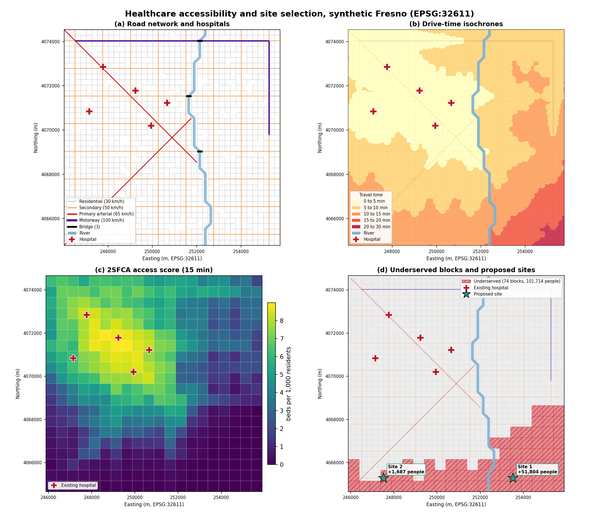
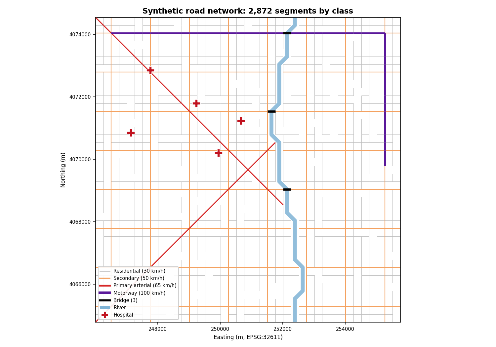
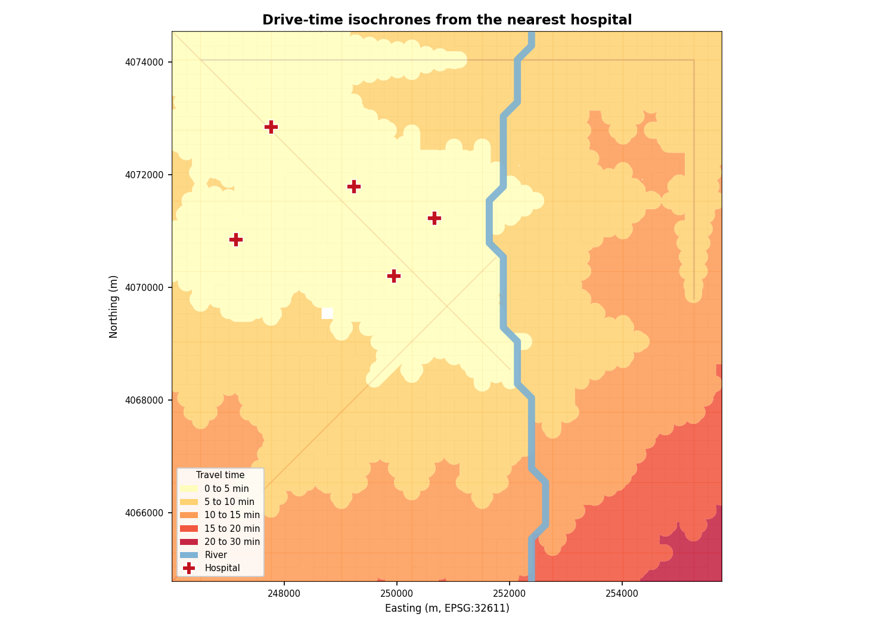
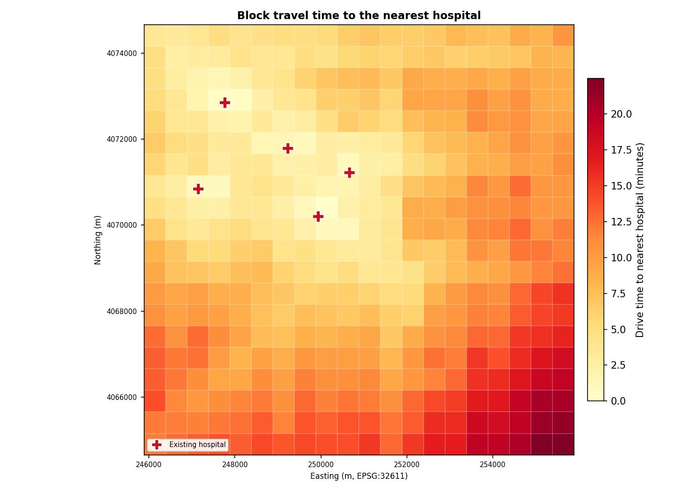
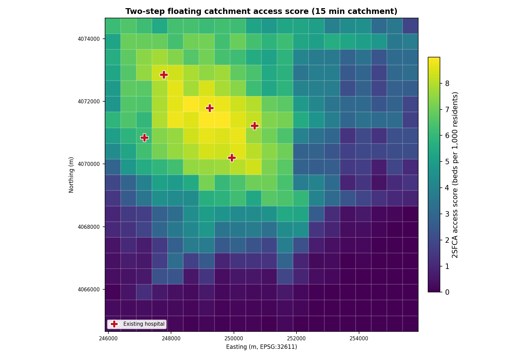
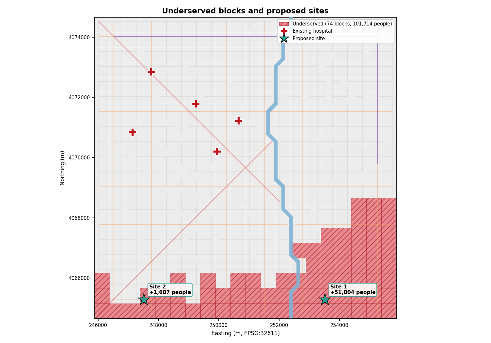
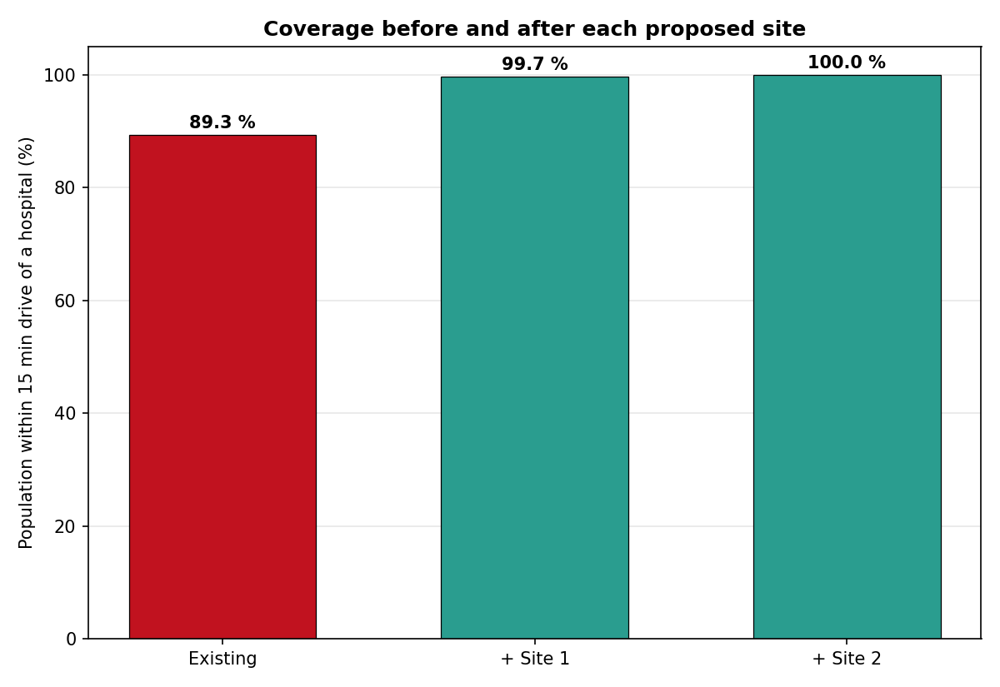

# 🏥 Healthcare Accessibility and Facility Site Selection

[](https://www.python.org/)
[](https://qgis.org/)
[](https://github.com/bhargavchintam/qgis-geospatial-projects/actions/workflows/ci.yml)
[](LICENSE)



## What this does

Many residents live close to a hospital in a straight line but far from it by road, especially when a river or a motorway is in the way. This project measures real drive-time access on a road network: it runs a multi-source Dijkstra from every hospital, draws isochrones, scores each census block with the two-step floating catchment area (2SFCA) method, flags underserved blocks, and then picks new facility sites with a greedy maximal-covering heuristic. The output is a set of GeoPackages, a summary JSON, six figures and an interactive web map.

Built for: health-system planners, county public-health GIS teams and urban planners who need to justify where the next clinic or hospital should go.

## Try it

- Interactive map (no install): https://bhargavchintam.github.io/qgis-geospatial-projects/healthcare-access-analysis/docs/map.html
- Streamlit app: `streamlit run app.py`  (live link placeholder: https://healthcare-access-analysis.streamlit.app, fill in after deploy)
- One-command demo:
  ```bash
  pip install -r requirements.txt
  python demo.py          # ~4 s, writes results/demo and docs/figures
  ```

## Results (from `python demo.py`, synthetic Fresno scene, seed 42)

Synthetic 10 km x 10 km city centred on Fresno, California (EPSG:32611), 40 x 40 street grid at 250 m spacing, a meandering north-south river with three bridges, two diagonal arterials, one motorway ring segment, 400 census-like blocks and 5 hospitals clustered in the north-west and centre.

| Metric | Value |
|---|---|
| Road network | 1,599 nodes, 2,872 edges, 722.9 km (2,206 residential, 567 secondary, 47 primary, 52 motorway), 3 bridges |
| Demand | 400 blocks, 500,002 residents |
| Supply | 5 hospitals, 1,709 beds |
| Catchment | 15 min drive, Gaussian decay |
| Population within 15 min of a hospital | 89.3 % before, 100.0 % after two new sites |
| Mean 2SFCA access score (beds per 1,000 residents) | 3.52 before, 4.26 after (population-weighted 3.42 to 4.22) |
| Mean / max block drive time to nearest hospital | 8.6 min / 22.5 min |
| Underserved blocks (bottom 20 % of population by score, or beyond 15 min) | 74 blocks, 101,714 residents before; 1 block, 830 residents after |
| Isochrone band areas (km²) | 0 to 5 min 29.4, 5 to 10 min 38.6, 10 to 15 min 25.4, 15 to 20 min 6.0, 20 to 30 min 1.5 |
| Candidate sites evaluated | 85 |
| Proposed site 1 | node 110 (x 253,511, y 4,065,285; lon -119.7592, lat 36.7013), newly covers 51,804 people, coverage 99.7 % |
| Proposed site 2 | node 86 (x 247,511, y 4,065,285; lon -119.8263, lat 36.6997), newly covers 1,687 people, coverage 100.0 % |
| Runtime | 3.96 s (data 0.38 s, analysis 0.71 s, rest is figures and the web map) |

The first site lands in the east-bank suburb south of the last bridge, which is exactly the area the underserved map flags. The second site only adds 1,687 people because one 15-minute catchment already reaches almost everyone left, a normal diminishing-returns result for the greedy maximal covering problem.

## Figures


*Synthetic street grid by road class with the river, the three bridges and the five hospitals.*


*Drive-time bands from the nearest hospital, 5 to 30 minutes; the south-east bank is the slowest area.*


*Block-level drive time to the nearest hospital.*


*2SFCA access score, beds per 1,000 residents reachable within 15 minutes.*


*Underserved blocks (hatched) and the two greedy maximal-covering sites with the population each one newly covers.*


*Share of residents within 15 minutes of a hospital before and after each proposed site.*

## How it works

1. **Travel-time graph.** The street network is an undirected `networkx` graph. Each edge has `length_m`, a `highway` class (residential 30, secondary 50, primary 65, motorway 100 km/h) and `travel_time_s = length / speed + junction delay`. The junction delay (25 / 18 / 12 / 0 s per segment) mimics stop signs and signals and gives realistic effective city speeds of about 16, 25, 40 and 100 km/h. Hospitals and block centroids are snapped to the nearest node with a KD-tree.

2. **Multi-source Dijkstra.** All hospital nodes are seeded at time 0 and one call to `networkx.multi_source_dijkstra` (weight `travel_time_s`) returns the drive time from the *nearest* hospital to every node, plus which hospital that is.

3. **Isochrones.** For each break (5, 10, 15, 20, 30 min) every road segment reached within the budget is collected; segments with only one end inside the budget are cut at the point where the budget runs out. The segments are buffered (0.6 x grid spacing) and unioned, then each band is differenced with the next smaller band so bands do not overlap.

4. **2SFCA access score.** With catchment size d0 (15 min) and decay weight f(d):

   Step 1, supply-to-demand ratio of hospital j with S_j beds and every block k within d0:

   `R_j = S_j / sum_k( P_k * f(d_kj) )`

   Step 2, access score of block i, summing every hospital within d0:

   `A_i = sum_j( R_j * f(d_ij) )`, reported as beds per 1,000 residents.

   `decay = "none"` uses f(d) = 1 inside the catchment (classic 2SFCA). `decay = "gaussian"` uses
   `f(d) = (exp(-0.5 (d/d0)^2) - exp(-0.5)) / (1 - exp(-0.5))`, which equals 1 at the hospital and 0 at the catchment edge, so a hospital 14 minutes away counts far less than one 3 minutes away.

5. **Underserved blocks.** A block is underserved when it has residents and either its access score is in the bottom 20 % of the population (population-weighted quantile) or its nearest hospital is beyond the threshold. The after-scenario reuses the before-scenario score cut-off so the two states are comparable.

6. **Greedy maximal covering (MCLP).** Candidate sites are every 4th grid row and column node at least 1 km from an existing hospital (85 candidates). Each candidate gets one bounded Dijkstra to find the blocks it can reach within d0. At every step the candidate that newly covers the most residents is chosen, the covered set is updated and the process repeats k times. The greedy solution is within (1 - 1/e) of the optimum for this submodular objective. Coverage is then recomputed with the new sites (200 beds each) to report the after-state.

## Use it in QGIS

- `qgis/styles/isochrones.qml`: categorized fill on `max_minutes` (YlOrRd).
- `qgis/styles/access_score_blocks.qml`: graduated fill on `access_score`, five quantile classes (viridis).
- `qgis/styles/hospitals.qml` and `qgis/styles/roads_by_class.qml`: markers and line widths.
- `qgis/processing/service_area_algorithm.py`: Processing algorithm "Service Area from Road Lines (Portfolio)". It builds a graph from any road line layer, runs a heapq Dijkstra from your facility points and outputs the dissolved service-area polygon for a cutoff in minutes.
- Load styles with Layer Properties > Symbology > Style > Load Style; add the script through Processing Toolbox > Scripts > Create New Script. Details in [qgis/README.md](qgis/README.md).

## Use it with real data

| Layer | Source | Notes |
|---|---|---|
| Road network | OpenStreetMap via OSMnx (`src.network_builder.load_osm_network("Fresno, California, USA")`) | `graph_from_place` > `add_edge_speeds` > `add_edge_travel_times` > `project_graph`; the loader collapses the MultiDiGraph to this project's attribute names |
| Hospitals | HIFLD Hospitals (points, `BEDS` field) | rename to `name`, `beds`; drop closed facilities |
| Demand units | Census ACS 5-year block groups with total population | any polygon layer with a `population` column works |
| Vulnerability | CDC/ATSDR Social Vulnerability Index (tract) | join `RPL_THEMES` to the blocks as `svi` for equity-weighted reporting |

`config.yaml` holds the study area and CRS, the speed and junction-delay tables, the catchment threshold, decay, isochrone breaks, the underserved quantile, the number of new sites and the candidate rules; the `real_data` block points to the OSM place name and the three input files. Replace the synthetic layers, keep everything in one projected CRS in metres, and run the same `src.pipeline.run_pipeline`.

## Project structure

```
healthcare-access-analysis/
├── README.md
├── LICENSE
├── requirements.txt
├── config.yaml
├── demo.py                       # one-command demo
├── app.py                        # Streamlit app
├── src/
│   ├── __init__.py
│   ├── utils.py                  # load_config, ensure_directory, save_gdf
│   ├── network_builder.py        # synthetic grid network, OSMnx loader, graph -> GeoDataFrames
│   ├── catchment.py              # KD-tree snapping, multi-source Dijkstra, isochrones
│   ├── accessibility.py          # 2SFCA, underserved blocks, coverage stats
│   ├── site_selection.py         # candidate nodes, greedy maximal covering
│   ├── synthetic_data.py         # generate_demo_data (roads, nodes, river, blocks, hospitals)
│   ├── pipeline.py               # run_pipeline shared by demo, app and tests
│   └── visualize.py              # figures and build_web_map
├── qgis/
│   ├── README.md
│   ├── styles/                   # isochrones, access_score_blocks, hospitals, roads_by_class
│   └── processing/service_area_algorithm.py
├── tests/                        # 43 tests
├── docs/
│   ├── figures/00_hero.png ... 06_coverage_before_after.png
│   └── map.html                  # Folium interactive map
└── results/                      # git-ignored demo output (GeoPackages, CSVs, summary.json)
```

## Tests

```bash
python -m pytest tests -q        # 43 passed
```

`test_demo.py` runs the whole pipeline on a 15 x 15 grid in about two seconds.

## Author

Bhargav Chintam, https://github.com/bhargavchintam. MIT License.
