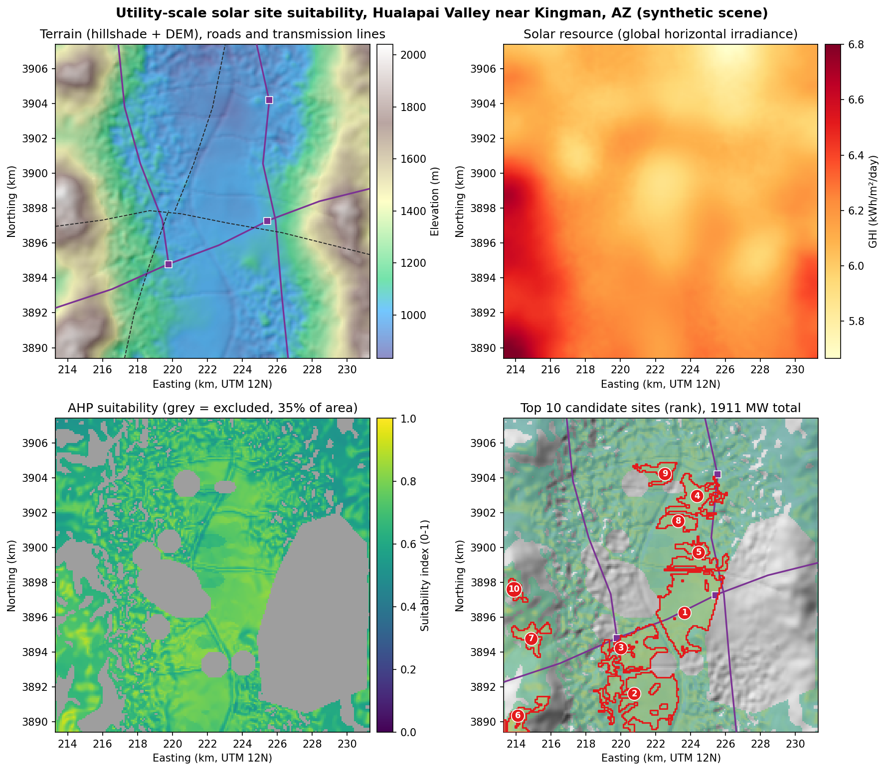
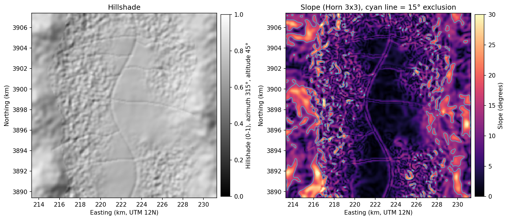
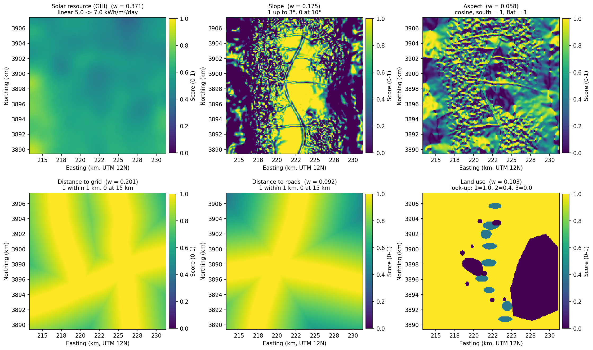
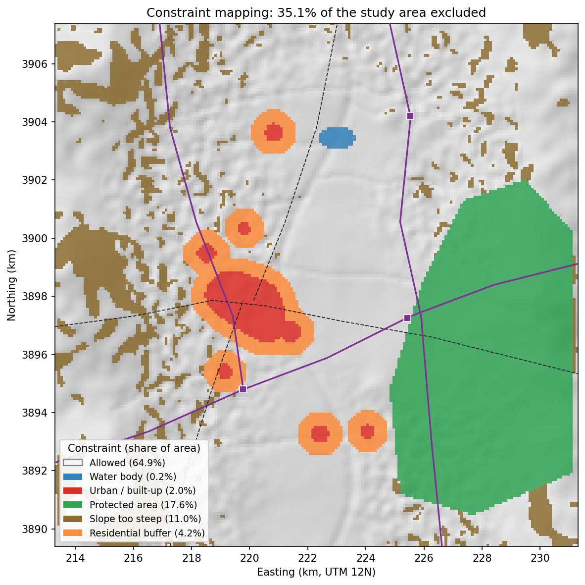
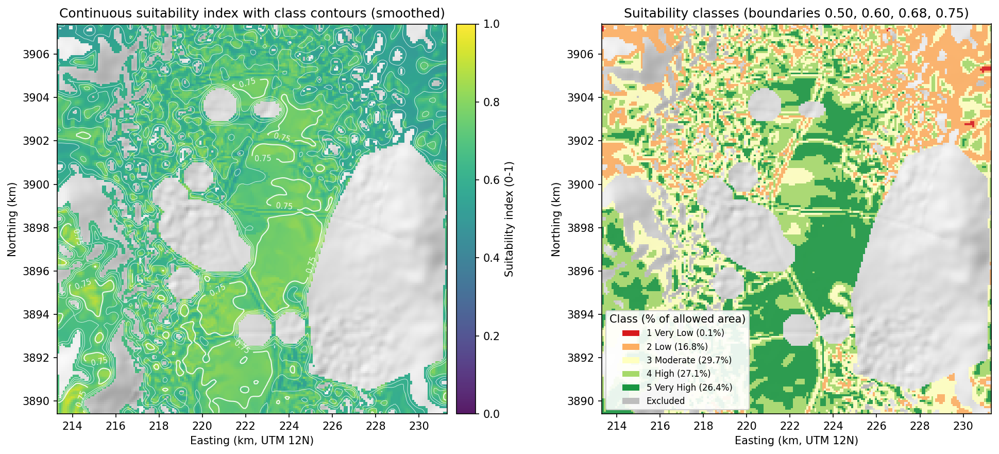
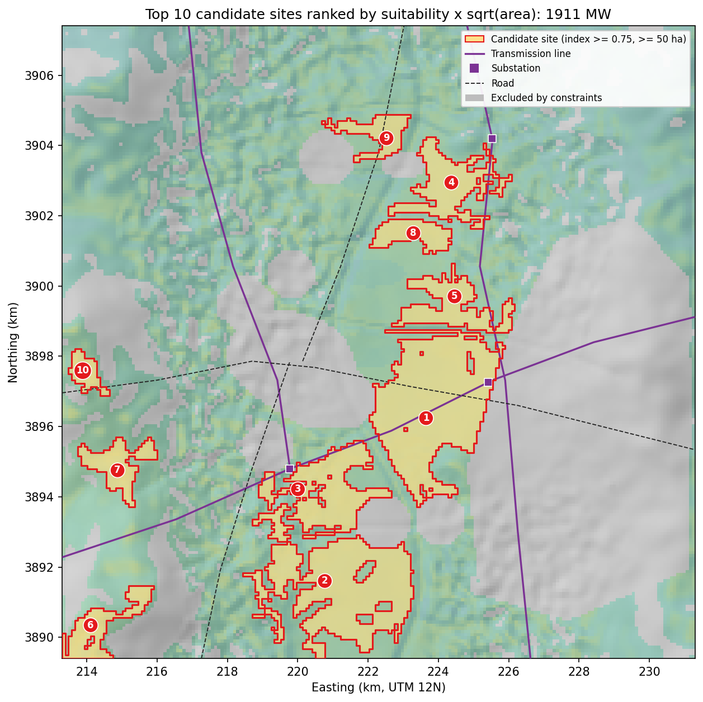
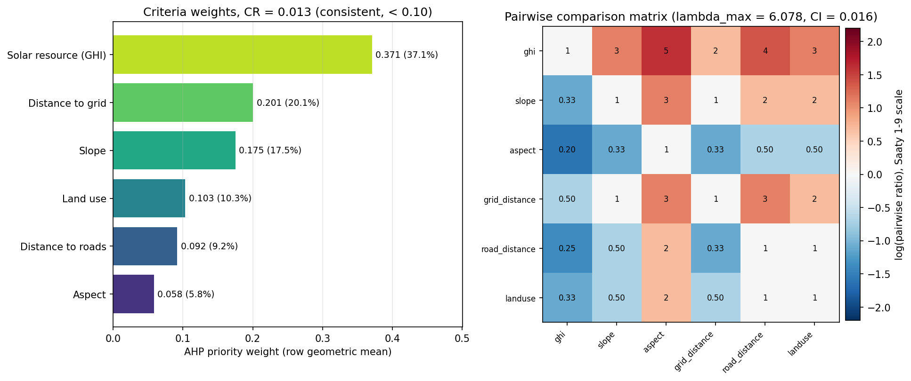
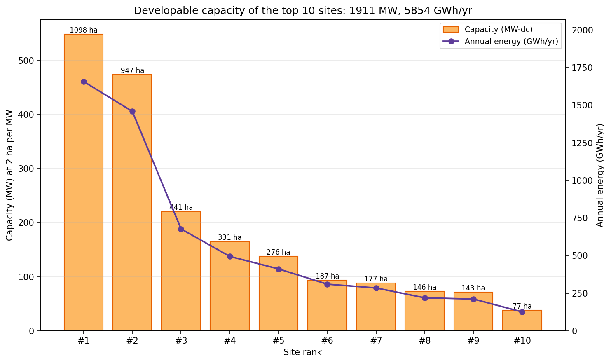

# ☀️ Utility-Scale Solar Farm Site Suitability

[](https://www.python.org/)
[](https://qgis.org/)
[](https://github.com/bhargavchintam/qgis-geospatial-projects/actions/workflows/ci.yml)
[](LICENSE)



## What this does

Finding land for a utility-scale photovoltaic plant means balancing sunshine, flat ground, grid access, road access and land use while staying away from towns, water and protected areas. This project does that as a GIS multi-criteria decision analysis: six criteria are standardised to 0 to 1, weighted with the Analytic Hierarchy Process (AHP) and combined in a weighted overlay, then hard constraints mask out land that cannot be used. The output is a suitability index raster, a five-class map, and a ranked list of candidate site polygons with estimated capacity (MW) and annual energy (GWh).

Built for: renewable energy developers, utility planners and GIS analysts doing early-stage solar site screening.

## Try it

- Interactive map (no install): https://bhargavchintam.github.io/qgis-geospatial-projects/solar-site-suitability/docs/map.html
- Streamlit app: `streamlit run app.py` (runs on your machine; there is no hosted version yet)
- One-command demo:
  ```bash
  pip install -r requirements.txt
  python demo.py          # ~4 s, writes results/demo and docs/figures
  ```

## Results (from `python demo.py`, synthetic Kingman, Arizona scene, seed 42)

Scene: 18 km x 18 km (324 km2) at 90 m, EPSG:32612, centred near 35.19 N, 114.05 W in the Hualapai Valley.

| Metric | Value |
|---|---|
| AHP weights (GHI / grid / slope / land use / roads / aspect) | 0.371 / 0.201 / 0.175 / 0.103 / 0.092 / 0.059 |
| AHP consistency | lambda_max 6.078, CI 0.016, CR 0.013 (consistent, < 0.10) |
| Area excluded by constraints | 35.1 % (protected 17.6, slope > 15 deg 11.0, residential buffer 4.2, urban 2.0, water 0.2) |
| Suitability classes (% of allowed area) | Very Low 0.1, Low 16.8, Moderate 29.7, High 27.1, Very High 26.4 |
| Candidate sites (index >= 0.75, >= 50 ha) | 10 |
| Total developable capacity | 1,911 MW, 5,854 GWh/yr |
| Best site | 549 MW on 1,098 ha, mean suitability 0.782, on the 345 kV line |

Top five sites:

| Rank | Area (ha) | Mean suitability | Capacity (MW) | Energy (GWh/yr) | Distance to grid (km) |
|---|---|---|---|---|---|
| 1 | 1097.5 | 0.782 | 548.8 | 1657.2 | 0.00 |
| 2 | 946.9 | 0.775 | 473.4 | 1459.0 | 0.80 |
| 3 | 441.4 | 0.799 | 220.7 | 677.7 | 0.00 |
| 4 | 331.3 | 0.770 | 165.7 | 495.1 | 0.00 |
| 5 | 276.2 | 0.776 | 138.1 | 412.0 | 0.00 |

## Figures


Hillshade and Horn slope from the synthetic DEM; the cyan line marks the 15 degree exclusion.


The six standardised criteria (0 = unsuitable, 1 = ideal) with their AHP weights and curve descriptions.


Excluded land by reason: water, urban, protected area, steep slope and the 500 m residential buffer.


Continuous suitability index with class contours (left) and the five-class map (right).


Top 10 candidate sites labelled by rank, with transmission lines, substations and roads.


AHP priority weights and the pairwise comparison matrix with the consistency check.


Capacity in MW per ranked site (bars) and annual energy in GWh (line).

## How it works

1. **Terrain.** Slope (degrees) and aspect (0 to 360, north = 0, flat = -1) from the DEM with Horn's 3x3 kernel, plus a hillshade (azimuth 315, altitude 45) for display. `src/terrain.py`.
2. **Distance rasters.** Euclidean distance in metres from every pixel to transmission lines, substations, roads and residential polygons (`scipy.ndimage.distance_transform_edt` on the rasterised features). Substations are folded into the grid criterion: `grid_distance = min(distance to line, distance to substation)`, because a plant can connect to either. `src/utils.py`.
3. **Standardisation.** Each criterion becomes a 0 to 1 score. `src/criteria.py`.

   | Criterion | Curve | Demo data | Real data |
   |---|---|---|---|
   | GHI (kWh/m2/day) | linear, 0 at 5.0, 1 at 7.0 | synthetic 5.6 to 6.8 field | NREL NSRDB |
   | Slope (deg) | 1 up to 3, linear to 0 at 10 | from synthetic DEM | USGS 3DEP DEM |
   | Aspect | (1 + cos(aspect - 180)) / 2, south = 1, flat = 1 | from synthetic DEM | USGS 3DEP DEM |
   | Distance to grid (m) | 1 within 1,000, linear to 0 at 15,000 | 3 lines, 3 substations | HIFLD transmission lines and substations |
   | Distance to roads (m) | 1 within 1,000, linear to 0 at 15,000 | highway + 2 roads | TIGER/Line roads |
   | Land use | look-up: desert scrub 1.0, agriculture 0.4, urban / water / protected 0 | synthetic codes 1 to 5 | NLCD reclassified |

4. **AHP weights.** Pairwise comparison matrix (Saaty 1 to 9 scale) in `config.yaml`, order ghi, slope, aspect, grid_distance, road_distance, landuse:

   ```
   ghi            1     3     5     2     4     3
   slope          1/3   1     3     1     2     2
   aspect         1/5   1/3   1     1/3   1/2   1/2
   grid_distance  1/2   1     3     1     3     2
   road_distance  1/4   1/2   2     1/3   1     1
   landuse        1/3   1/2   2     1/2   1     1
   ```

   Weights are the normalised row geometric means, `w_i = (prod_j a_ij)^(1/n) / sum_k (prod_j a_kj)^(1/n)`. The principal eigenvalue is estimated as `lambda_max = mean((A w) / w)`, then `CI = (lambda_max - n) / (n - 1)` and `CR = CI / RI` with `RI = 1.24` for n = 6. Result: CR = 0.013, well under the 0.10 limit. `src/ahp.py`.
5. **Constraints.** A pixel is excluded when it is water (code 4), urban (3) or protected (5), when slope > 15 degrees, or when it lies within 500 m of a residential polygon. A reason raster (1 water, 2 urban, 3 protected, 4 steep, 5 buffer) is kept for reporting. `src/criteria.py`.
6. **Weighted overlay.** `index = sum_i w_i * score_i` on allowed pixels, NaN elsewhere. Classes: Very Low < 0.50, Low < 0.60, Moderate < 0.68, High < 0.75, Very High >= 0.75. `src/suitability.py`.
7. **Candidate sites.** Contiguous (8-connected) patches with index >= 0.75 and area >= 50 ha are vectorised. For each site:
   - `capacity_mw = area_ha / 2` (about 2 ha per MW for fixed-tilt utility PV; NREL, Ong et al. 2013 report about 2.2 ha per MWac of direct area),
   - `annual_gwh = area_ha * 10000 * mean_GHI * 365 * 0.20 * 0.40 * 0.85 / 1e6` (module efficiency 0.20, ground cover ratio 0.40, performance ratio 0.85),
   - `dist_to_grid_km` = nearest grid distance inside the site,
   - `rank_score = mean_suitability * sqrt(area_ha / largest_area_ha)`; the square root rewards size without letting a huge mediocre patch beat a smaller excellent one. Rank 1 is the highest score.

All assumptions live in `config.yaml`.

## Use it in QGIS

- `qgis/styles/solar_suitability.qml`: red to green pseudocolor for the 0 to 1 index.
- `qgis/styles/suitability_classes.qml`: exact colours and labels for classes 1 Very Low to 5 Very High.
- `qgis/styles/constraints.qml`: 0 excluded in grey, 1 allowed transparent.
- `qgis/styles/candidate_sites.qml`: sites graduated by `capacity_mw`, labelled with `rank`.
- `qgis/processing/solar_suitability_algorithm.py`: Processing Toolbox script "Weighted Suitability Overlay with Constraints (Portfolio)" that normalises any set of rasters, applies weights and a constraint raster, and writes the index.

Load a style with Layer Properties > Symbology > Style > Load Style. Install the script with Processing Toolbox > Scripts > Create New Script, paste, save. Details in [qgis/README.md](qgis/README.md).

## Use it with real data

| Layer | Source | Notes |
|---|---|---|
| GHI | [NREL NSRDB](https://nsrdb.nrel.gov/) | multi-year mean, kWh/m2/day, resample to the DEM grid |
| DEM | [USGS 3DEP](https://www.usgs.gov/3d-elevation-program) | 1/3 arc-second, reproject to UTM (EPSG:32612 for Mohave County) |
| Transmission lines, substations | [HIFLD Open Data](https://hifld-geoplatform.opendata.arcgis.com/) | Electric Power Transmission Lines, Electric Substations |
| Land cover | [NLCD](https://www.mrlc.gov/) | reclassify to 1 scrub, 2 agriculture, 3 urban, 4 water, 5 protected |
| Protected areas | [USGS PAD-US](https://www.usgs.gov/programs/gap-analysis-project/science/pad-us-data-overview) | burn into the land-cover raster as code 5 |
| Roads | [TIGER/Line](https://www.census.gov/geographies/mapping-files/time-series/geo/tiger-line-file.html) | primary and secondary roads |
| Residential | NLCD developed classes polygonised, or county parcels | used for the buffer constraint |

Point the `inputs:` block of `config.yaml` at your files (same CRS and grid for all rasters), then call `src.pipeline.run_pipeline(config["inputs"], config, out_dir=...)`. The demo replaces these paths with the synthetic scene it writes to `results/demo/data/`.

## Project structure

```
solar-site-suitability/
├── README.md
├── LICENSE
├── requirements.txt
├── config.yaml                  # study area, curves, AHP matrix, constraints, site rules
├── demo.py                      # one-command demo
├── app.py                       # Streamlit app
├── src/
│   ├── __init__.py
│   ├── utils.py                 # raster/vector I/O, rasterize, distance rasters
│   ├── terrain.py               # slope, aspect, hillshade (Horn)
│   ├── criteria.py              # standardisation curves and constraint mask
│   ├── ahp.py                   # AHP engine (row geometric mean, CR check)
│   ├── suitability.py           # weighted overlay, classes, site extraction, ranking
│   ├── pipeline.py              # run_pipeline(): the full chain
│   ├── synthetic_data.py        # synthetic Kingman scene
│   └── visualize.py             # figures and Folium map
├── qgis/
│   ├── README.md
│   ├── styles/                  # 4 .qml styles
│   └── processing/solar_suitability_algorithm.py
├── tests/                       # pytest suite (25 tests)
├── docs/
│   ├── figures/00_hero.png ... 07_site_capacity.png
│   └── map.html                 # Folium interactive map
└── results/                     # git-ignored demo output
```

## Tests

```bash
python -m pytest tests -q
```

25 tests: terrain (flat and tilted planes), criteria curves and constraint mask, AHP (weights sum to 1, identity matrix, inconsistent matrix flagged), overlay and site extraction, and an end-to-end run at 40 x 40 pixels in under 10 seconds.

## Author

Bhargav Chintam, https://github.com/bhargavchintam. MIT License.
