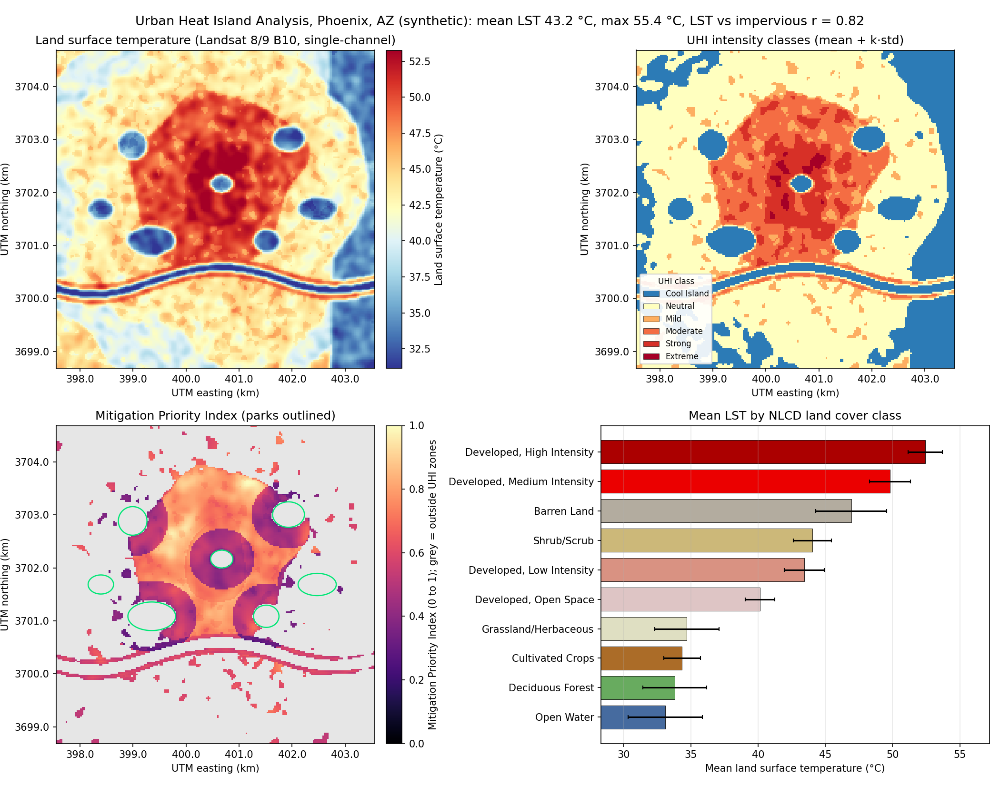
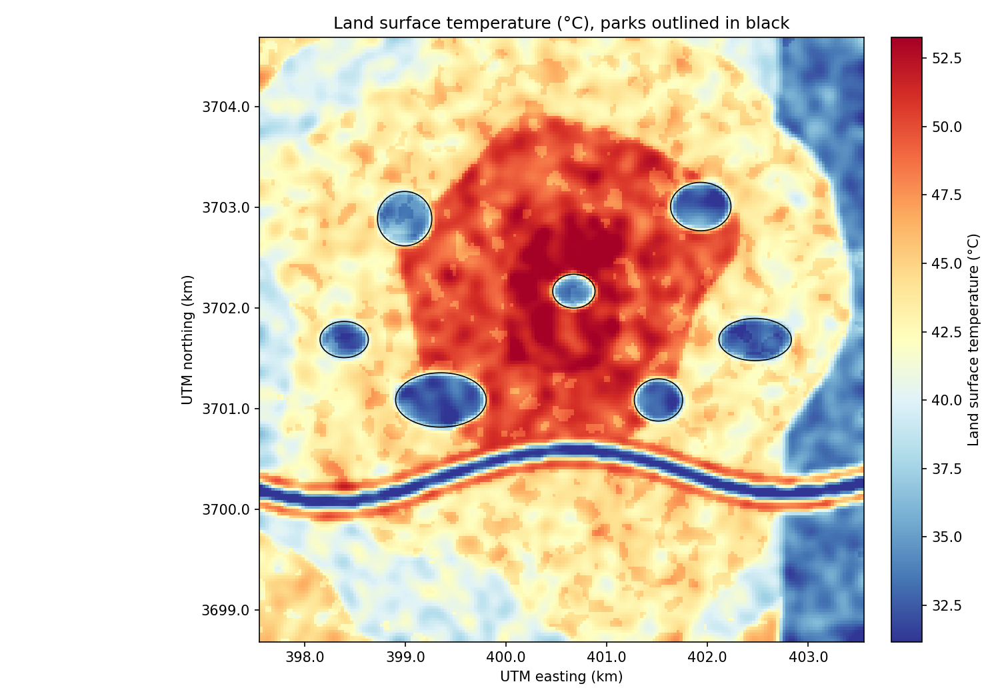
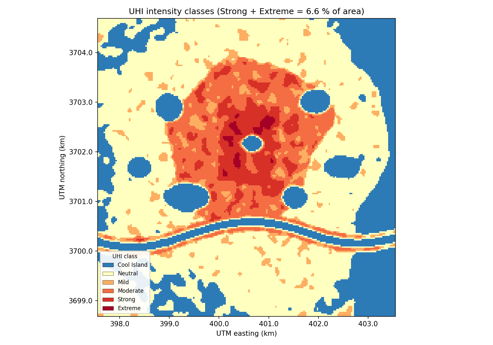
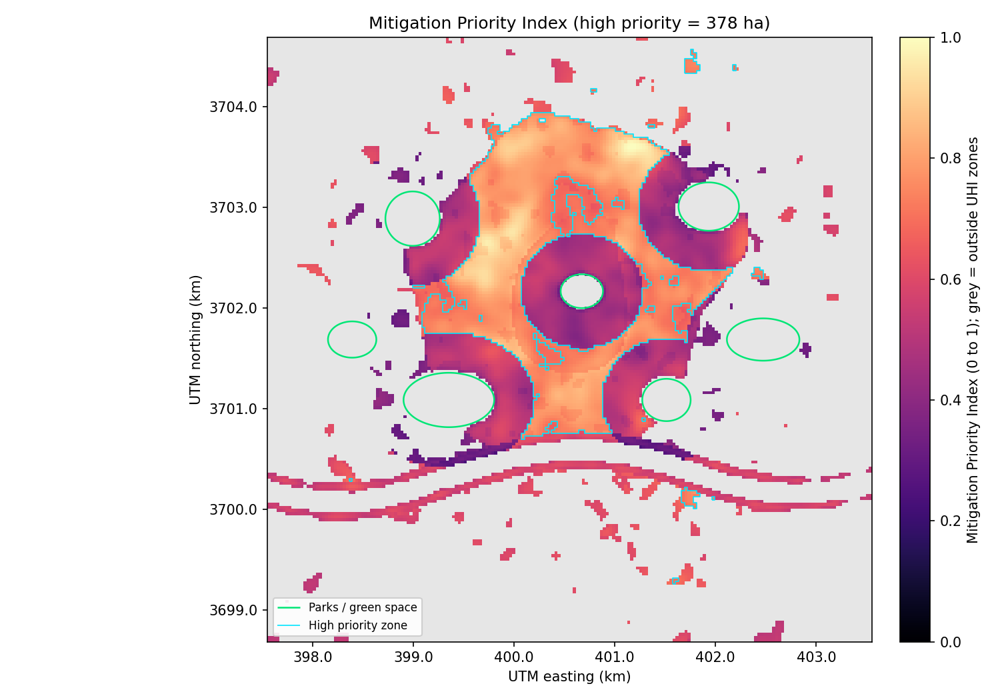
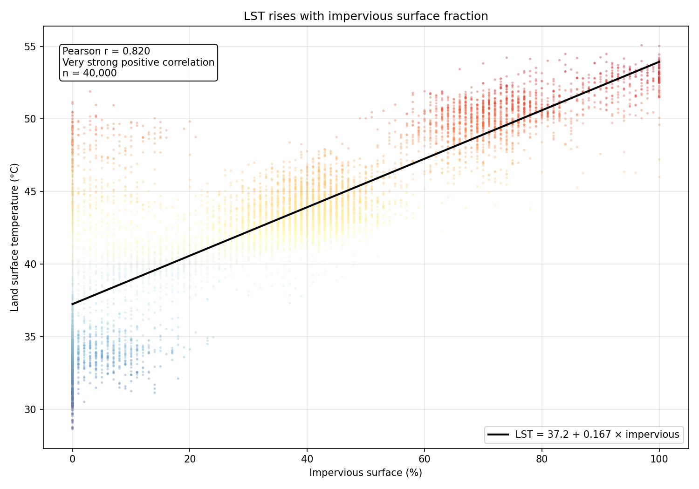
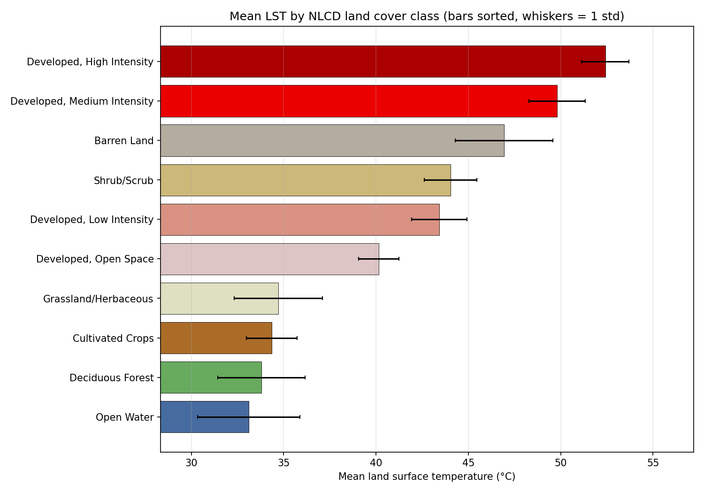
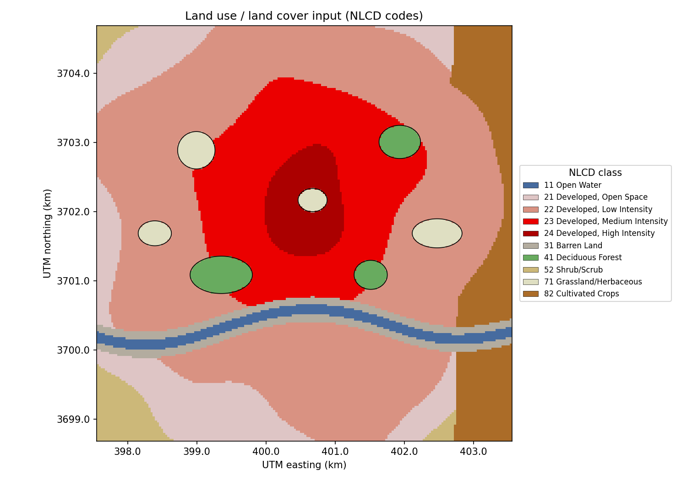

# 🌡️ Urban Heat Island Analysis and Mitigation Mapping

[](https://www.python.org/)
[](https://qgis.org/)
[](https://github.com/bhargavchintam/qgis-geospatial-projects/actions/workflows/ci.yml)
[](LICENSE)



## What this does

Cities are hotter than the land around them, and the hottest blocks are often where the most people live with the least shade. This pipeline turns a Landsat 8/9 thermal scene into a land surface temperature (LST) map, classifies urban heat island (UHI) intensity from the scene mean and standard deviation, links the heat to land cover and impervious surface, and combines heat, population and green-space deficit into a Mitigation Priority Index (MPI). The outputs are GeoTIFFs, GeoPackage zones, CSV statistics, figures and an interactive web map.

Built for: city planners, sustainability teams and GIS analysts who need to decide where tree planting, cool roofs and new parks will help the most people.

## Try it

- Interactive map (no install): https://bhargavchintam.github.io/qgis-geospatial-projects/urban-heat-island-analysis/docs/map.html
- Streamlit app: `streamlit run app.py`  (live link placeholder: https://urban-heat-island-analysis.streamlit.app, fill in after deploy)
- One-command demo:
  ```bash
  pip install -r requirements.txt
  python demo.py          # ~2 s, writes results/demo and docs/figures
  ```

The demo builds a synthetic Phoenix, Arizona summer scene (200 x 200 pixels at 30 m, EPSG:32612) with a downtown core, suburbs, a river, parks and cropland, so everything runs offline. Real Landsat, NLCD and census inputs plug in through `config.yaml` and `scripts/run_pipeline.py`.

## Results (from `python demo.py`, synthetic Phoenix scene, seed 42)

| Metric | Value |
|--------|-------|
| Scene | 200 x 200 px at 30 m (36 km2), EPSG:32612 |
| Mean LST | 43.16 °C |
| Max LST | 55.39 °C |
| Min LST | 27.91 °C |
| Rural baseline LST (forest, shrub, grass, crops) | 36.00 °C |
| Max UHI intensity above rural baseline | 19.38 °C |
| UHI class area: Cool Island / Neutral / Mild | 23.91 % / 49.82 % / 6.96 % |
| UHI class area: Moderate / Strong / Extreme | 12.70 % / 6.04 % / 0.57 % |
| Strong + Extreme UHI | 6.61 % of area |
| LST vs impervious surface, Pearson r | 0.820 (very strong positive) |
| LST vs impervious surface, slope | 0.167 °C per 1 % impervious |
| MPI high / medium / low priority | 10.50 % / 14.04 % / 1.73 % of area |
| High priority zone area | 378.09 ha |
| Medium priority zone area | 505.44 ha |
| Hottest land cover classes (mean LST) | Developed High Intensity 52.42 °C, Developed Medium Intensity 49.81 °C, Barren Land 46.93 °C |
| Coolest land cover classes (mean LST) | Open Water 33.11 °C, Deciduous Forest 33.80 °C, Cultivated Crops 34.36 °C |
| Runtime | 1.3 s |

All numbers come from `results/demo/summary.json`, written by the demo run.

## Figures


Land surface temperature in °C from the single-channel method, parks outlined in black.


UHI intensity classes from mean + k * std thresholds; the downtown core and the dry river banks stand out.


Mitigation Priority Index with parks (green) and the high priority zones (cyan). Grey is outside UHI zones.


Every pixel of LST against impervious surface percent with the fitted line and Pearson r.


Mean LST per NLCD land cover class, sorted, whiskers show one standard deviation.


The NLCD land cover input used for the correlation and the rural baseline.

## How it works

1. **Brightness temperature.** Landsat Collection 2 Level-2 thermal band: `BT (K) = DN * 0.00341802 + 149.0`. For Level-1 input the pipeline uses the radiance route `L = ML * Qcal + AL` and `BT = K2 / ln(K1 / L + 1)`.
2. **NDVI.** `NDVI = (NIR - Red) / (NIR + Red)` from bands 5 and 4.
3. **Proportion of vegetation.** `Pv = ((NDVI - NDVI_soil) / (NDVI_veg - NDVI_soil))^2` with soil threshold 0.2 and vegetation threshold 0.5.
4. **Emissivity.** 0.966 below the soil threshold (water, bare soil, pavement), `0.004 * Pv + 0.986` for mixed pixels, 0.973 above the vegetation threshold.
5. **Land surface temperature.** `LST = BT / (1 + (lambda * BT / rho) * ln(emissivity))` with `lambda = 10.895 um` and `rho = 1.438e-2 m K`, then converted to °C.
6. **UHI anomaly.** LST minus the mean LST of the rural classes (NLCD 41, 42, 43, 52, 71, 81, 82). Without land cover the scene mean is used.
7. **UHI classes.** Class edges come from the scene mean and standard deviation of LST:

   | Class | Threshold | Description |
   |-------|-----------|-------------|
   | Extreme | LST >= mean + 2.0 std | Critical heat zones |
   | Strong | LST >= mean + 1.5 std | Significant heat accumulation |
   | Moderate | LST >= mean + 1.0 std | Notable temperature elevation |
   | Mild | LST >= mean + 0.5 std | Slight temperature increase |
   | Neutral | within +/- 0.5 std of the mean | Near the scene average |
   | Cool Island | LST < mean - 0.5 std | Parks, water, irrigated fields |

8. **Land cover links.** Cross-tabulation of UHI classes against NLCD codes, mean LST per class, and Pearson r plus linear regression of LST against impervious surface percent.
9. **Mitigation Priority Index.**

   `MPI = w1 * norm(thermal anomaly) + w2 * norm(population density) + w3 * green_space_deficit`

   with default weights 0.40 / 0.35 / 0.25. The green-space deficit is 1 for pixels farther than 400 m from any park. MPI is computed only inside Mild or stronger UHI zones, rescaled to 0..1, and split into High (>= 0.7), Medium (0.4 to 0.7) and Low priority zones that are vectorised to a GeoPackage.

## Use it in QGIS

- `qgis/styles/lst_celsius.qml`: pseudocolor ramp 20 to 60 °C for `lst_celsius.tif`.
- `qgis/styles/uhi_classified.qml`: exact classes 0 to 5 (Cool Island to Extreme) for `uhi_classified.tif`.
- `qgis/styles/mitigation_priority_zones.qml`: categorized High / Medium / Low fill for `mitigation_priority_zones.gpkg`.
- `qgis/processing/uhi_lst_algorithm.py`: Processing Toolbox script "Land Surface Temperature from Landsat 8/9 L2 (Portfolio)" that runs the same single-channel LST formula on your own bands.
- Load styles with Layer Properties > Symbology > Style > Load Style. Install the script with Processing Toolbox > Scripts > Create New Script. Details in [qgis/README.md](qgis/README.md).

## Use it with real data

| Input | Source | File expected by `config.yaml` |
|-------|--------|-------------------------------|
| Landsat 8/9 Collection 2 Level-2 (ST_B10, SR_B4, SR_B5) | [USGS EarthExplorer](https://earthexplorer.usgs.gov/) | `data/LC09_B10.TIF`, `data/LC09_B4.TIF`, `data/LC09_B5.TIF` |
| Land cover codes | [NLCD](https://www.mrlc.gov/) | `data/nlcd_lulc.tif` |
| Impervious surface percent | [NLCD Impervious](https://www.mrlc.gov/) | `data/impervious.tif` |
| Population density (people per km2) | [US Census TIGER](https://www.census.gov/geographies/mapping-files/time-series/geo/tiger-line-file.html) or WorldPop, rasterised | `data/population_density.tif` (`mitigation.population_raster`) |
| Parks and green space polygons | [OpenStreetMap](https://www.openstreetmap.org/) (`leisure=park`) | `data/parks_greenspace.gpkg` (`mitigation.greenspace_vector`) |

Steps: reproject and clip every layer to the same 30 m grid in EPSG:32612, set `data_directory` and the two `mitigation` paths in `config.yaml`, then run `python scripts/run_pipeline.py --config config.yaml --output results/real --figures`. `scripts/download_data.py` can fetch the Landsat scenes through the USGS M2M API with your own account.

## Project structure

```
urban-heat-island-analysis/
├── README.md
├── LICENSE
├── requirements.txt
├── config.yaml               # study area, constants, thresholds, weights, data paths
├── demo.py                   # one-command synthetic demo
├── app.py                    # Streamlit app
├── src/
│   ├── __init__.py
│   ├── synthetic_data.py     # generate_demo_data(): synthetic Phoenix scene
│   ├── pipeline.py           # run_pipeline(): chains the four modules, builds summary
│   ├── lst_processor.py      # DN -> BT -> NDVI -> emissivity -> LST, anomaly
│   ├── uhi_classifier.py     # mean + k*std classes, zone polygons
│   ├── lulc_correlator.py    # cross-tab, LST by class, impervious regression
│   ├── mitigation_mapper.py  # MPI raster and priority zones
│   ├── visualize.py          # figures and build_web_map()
│   └── utils.py              # config, raster/vector I/O helpers
├── qgis/
│   ├── README.md
│   ├── styles/               # lst_celsius.qml, uhi_classified.qml, mitigation_priority_zones.qml
│   └── processing/uhi_lst_algorithm.py
├── scripts/
│   ├── run_pipeline.py       # same pipeline on real data
│   └── download_data.py      # USGS M2M download helper
├── tests/
│   ├── test_lst_processor.py
│   └── test_demo.py          # end-to-end on a 40 x 40 scene
├── docs/
│   ├── figures/              # 00_hero.png ... 06_lulc_map.png
│   └── map.html              # Folium interactive map
└── results/                  # git-ignored demo output (rasters, vectors, statistics, summary.json)
```

## Tests

```bash
python -m pytest tests -q
```

15 tests: 11 unit tests for NDVI, emissivity and LST maths, plus 4 end-to-end tests that generate a tiny scene, run the whole pipeline, and check shapes, value ranges, output files, the hero figure and the web map. The suite runs in about 2 seconds.

## Author

Bhargav Chintam, https://github.com/bhargavchintam. MIT License.
